# KidBoard

[English](README.md) | [Deutsch](README.de.md)

Ein quelloffener, icon-basierter Familienkalender und Speiseplan für ein Wand-Tablet im
Kiosk-Modus. Gedacht für Kinder (etwa 3-8 Jahre), die noch nicht lesen können: große Icons
statt Text. Eltern pflegen weiter ihren Google Kalender; KidBoard liest die geheimen
iCal-Adressen serverseitig und zeigt eine ruhige Übersicht und Wochenansicht.

## Funktionen

- **Vier-Tage-Übersicht:** Heute ist eine große Karte (ganztägige Termine als Banner, ein
  "vorbei"-Streifen für Erledigtes, eine "jetzt"-Linie, der nächste Termin hervorgehoben,
  "+N" für alles, was nicht mehr passt), danach die nächsten drei Tage.
- **Wochenansicht:** die nächsten sieben Tage auf einen Blick, mit Mahlzeiten in jeder Spalte.
- **"Wie oft noch schlafen?"-Countdown:** Monde zählen die Nächte bis zu besonderen Terminen
  (Geburtstag, Urlaub, ...); am großen Tag wird daraus ein Konfetti-Popper.
- **Mahlzeiten:** Frühstück, Mittag und Abendessen aus einem eigenen Kalender, als Teller
  unter jedem Tag.
- **Schule: "Was mitbringen?":** `Mitbringen: 👟 🩱` in die Terminbeschreibung schreiben, und
  die Kachel zeigt kleine Emoji-Chips; ab dem Vorabend sagt ein 🎒-Bereich auf der heutigen
  Karte jedem Kind, was einzupacken ist, bis der Termin beginnt. Schulfächer bekommen ein
  Icon, ganz ohne Emoji im Titel.
- **Emoji-Icons:** das Emoji im Termintitel ist das Bild; Titel ohne Emoji bekommen ein
  Stichwort-Icon (Deutsch + Englisch).
- **Ein oder mehrere Kinder:** jedes Kind hat ein Emoji und eine Farbe, genutzt als
  Kachel-Tönung und Abzeichen.
- **Nachtmodus:** gedimmte Farben abends und nachts, nach der Uhr deiner Zeitzone.
- **Offline:** installierbare PWA, die den letzten guten Plan behält und "Offline · Stand von
  ..." zeigt.
- **Kiosk-tauglich:** hält den Bildschirm wach, verschiebt sich leicht gegen Einbrennen,
  Vollbild-Knopf mit langem Druck, Rückkehr zur Übersicht nach Inaktivität.
- iCal-URLs bleiben geheim auf dem Server, nie im Browser. Deutsche und englische Oberfläche.

## Screenshots

Synthetische Demo-Daten (erzeugt mit `pnpm screenshots`; alle Bilder gibt es auch in
2000x1200 in [`docs/screenshots/`](docs/screenshots/)). Die Demo-Oberfläche ist englisch.

| Übersicht (heute + 3 Tage)                                   | Wochenansicht                                                     |
| ------------------------------------------------------------ | ----------------------------------------------------------------- |
| 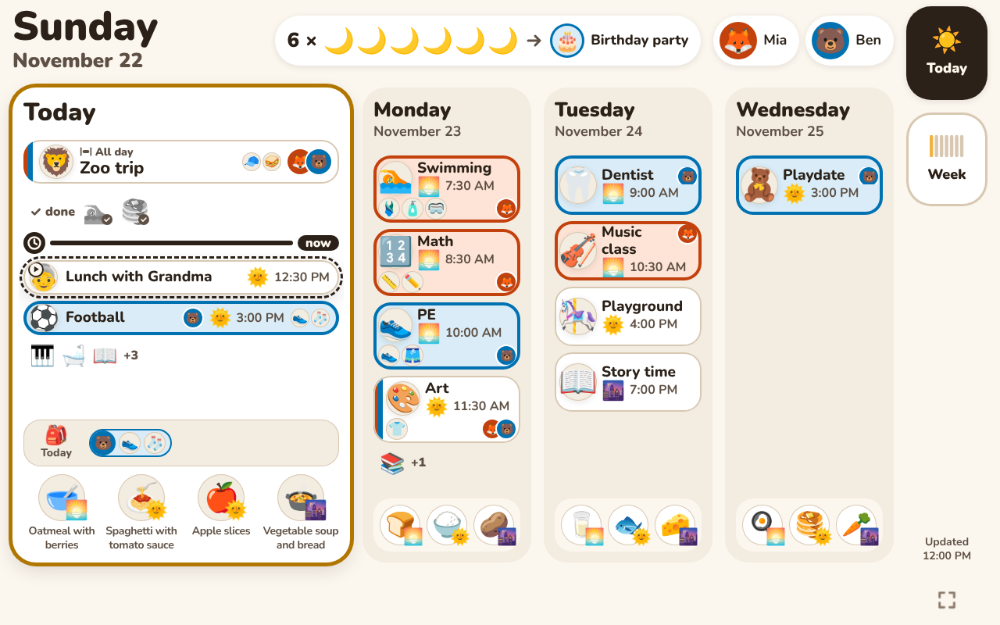        | 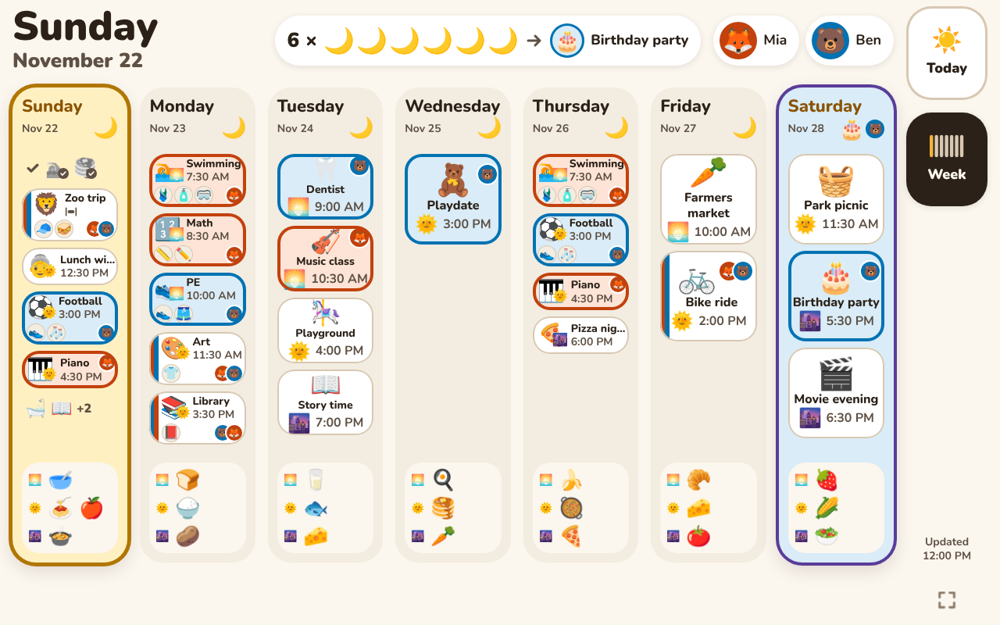        |
| 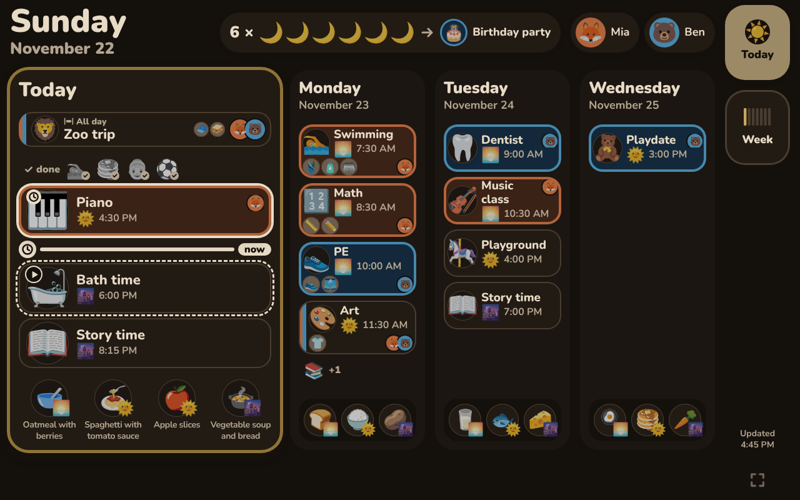 | 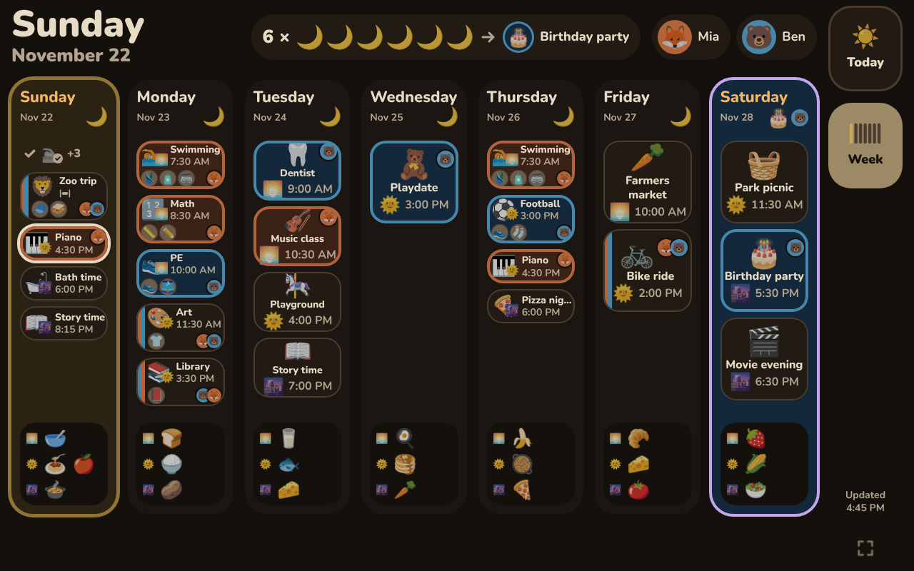 |

Der Countdown "Wie oft noch schlafen?" wird am großen Tag zum Konfetti-Popper:

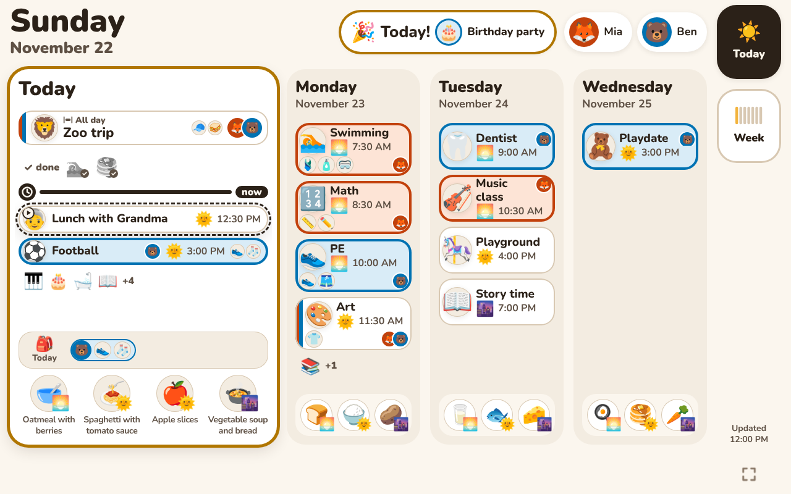

| 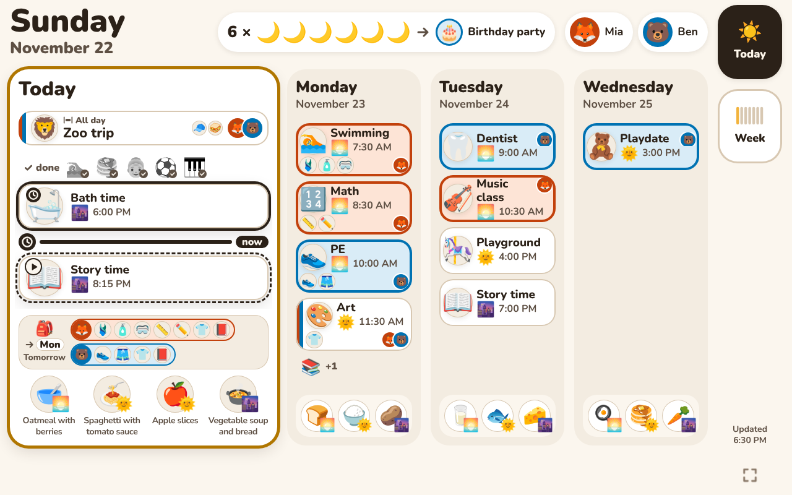 | 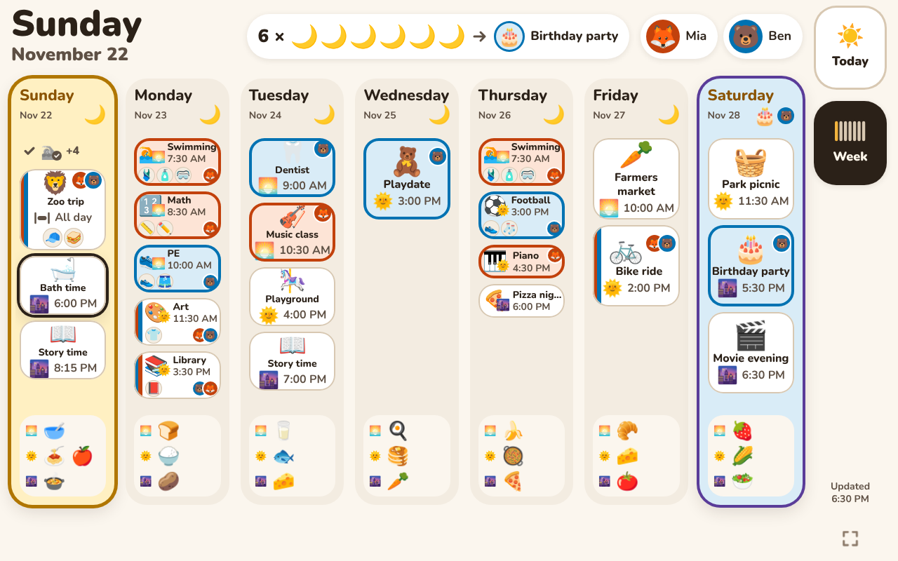 |
| ------------------------------------------------------------------------------------------------------------------- | ----------------------------------------------------------------------------------------------------- |

Zustände:

| Leerer Tag                                                            | Laden                                                       |
| --------------------------------------------------------------------- | ----------------------------------------------------------- |
| 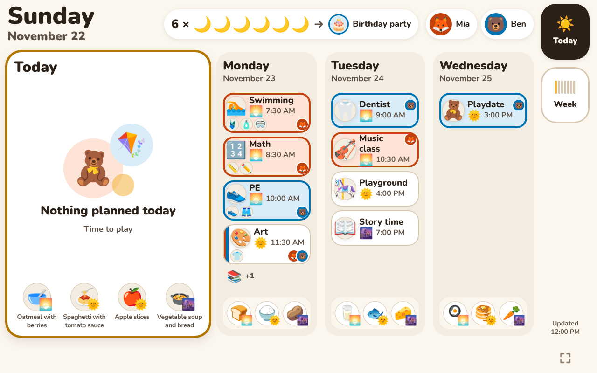 | 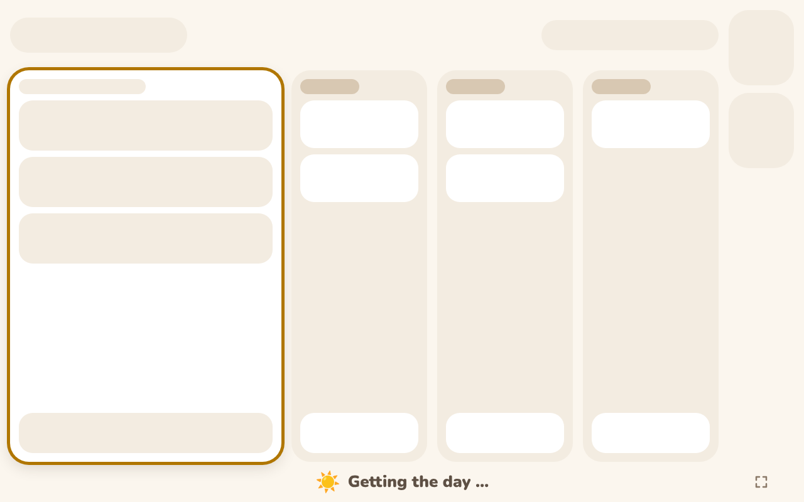 |

| Offline (letzter guter Plan, mit Hinweis)                       | Fehler (mit Fehlercode für Eltern)                          |
| --------------------------------------------------------------- | ----------------------------------------------------------- |
| 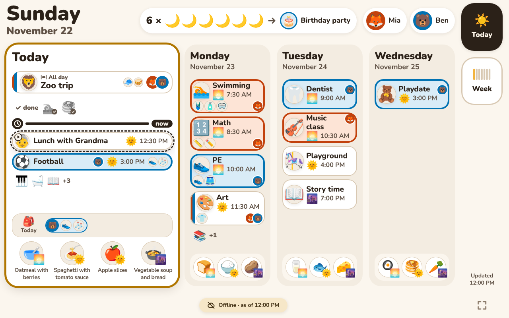 | 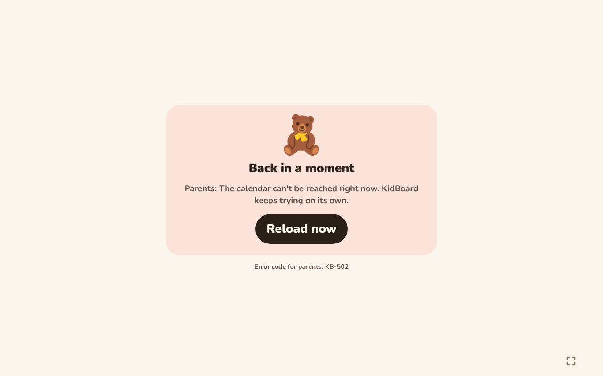 |

## Google-Kalender einrichten

1. **Eigene Kalender anlegen** im Google Kalender (Web, nicht die Handy-App): links
   "Weitere Kalender" > "+" > "Neuen Kalender erstellen". Ein guter Start ist ein Kalender für
   alles, was die Kinder machen (zum Beispiel "Kinder"), und einer für Essen (zum Beispiel
   "Essen"). Du kannst auch pro Kind einen Kalender anlegen; dann gehört jeder Termin darin
   zu diesem Kind, ohne Namen im Titel.
2. **Geheime Adresse finden:** Einstellungen (Zahnrad) > unter "Einstellungen für meine
   Kalender" den Kalender wählen > "Kalender integrieren" > **Geheime Adresse im iCal-Format**.
   Kopieren. Sie beginnt mit `https://calendar.google.com/calendar/ical/...` und endet auf
   `basic.ics`. Nicht die "Öffentliche Adresse" verwenden.
3. **Als Secret hinterlegen:** pro Kalender ein Worker-Secret `CAL_<ID>_URL`, wobei `<ID>` die
   Kalender-`id` aus deinen Einstellungen in Großbuchstaben ist (`kinder` -> `CAL_KINDER_URL`).
   Siehe [Deployment](#deployment) und [docs/CONFIG.md](docs/CONFIG.md).
4. **Termine wie gewohnt anlegen.** Serientermine, ganztägige und mehrtägige Termine
   funktionieren. Titel wie im nächsten Abschnitt beschrieben vergeben.

Gut zu wissen:

- **Der geheime Link ist ein Passwort.** Wer ihn hat, kann den ganzen Kalender lesen. Niemals
  ins Repository, in einen Chat, einen Screenshot oder ein Issue. Ist er durchgesickert, auf
  derselben Google-Seite zurücksetzen ("Geheime Adresse zurücksetzen") und das Worker-Secret
  aktualisieren.
- **Freigabe:** Für KidBoard musst du den Kalender mit niemandem teilen; der geheime Link
  genügt. Für andere Erwachsene den Kalender normal mit deren Google-Konto teilen, dann musst
  du den Link nie herausgeben.
- **Private Details landen auf dem Board.** Was im Titel steht, hängt an der Wand. Sensibles
  gehört nicht in Titel. Beschreibungen bleiben auf dem Server; nur die Emoji einer
  Mitbringen-Zeile (siehe [Mitbringen-Liste](#mitbringen-liste)) werden genutzt.
- Google braucht manchmal eine Weile (Minuten bis einige Stunden), bis Änderungen im iCal-Feed
  erscheinen, und KidBoard puffert Feeds (Standard eine Stunde, `KIDBOARD_CACHE_TTL`). Ein
  neuer Termin erscheint also nicht sofort.

## Titel-Konventionen im Kalender

Der Titel ist die einzige Schnittstelle: schreiben, KidBoard macht ein Bild daraus.

- **Emoji = das Bild.** Ein Emoji am Anfang des Titels wird zum Icon, der Rest ist der Titel:
  `⚽ Fußball`. Emoji mit Hautton, Flaggen und Familien-Sequenzen funktionieren auch. Jedes
  einzelne Emoji zählt, es gibt keine feste Liste.
- **Ohne Emoji:** KidBoard sucht ein bekanntes Wort (deutsch und englisch, z. B. Kita,
  Zahnarzt, dentist, swimming, Geburtstag, Klavier) und nimmt ein passendes Icon. Passt
  nichts, bekommen Termine 📅 und Mahlzeiten 🍽️. Besser ein Emoji setzen; es ist immer richtig.
- **Kinder:** Namen und Doppelpunkt voranstellen: `Mia: 🩰 Ballett`. Mehrere Kinder mit
  Komma, `+`, `&`, "und" oder "and": `Mia, Ben: 🛁 Baden`. `Alle:` / `All:` / `Everyone:`
  bedeutet alle Kinder. Die Namen müssen zu einem konfigurierten Kind passen (Groß-/Kleinschreibung
  egal); alles andere vor einem Doppelpunkt bleibt Teil des Titels (`Tipp: Mütze mitnehmen`).
  Ohne Namen gehört ein Termin zum Kind seines Kalenders, bzw. zu allen, wenn der Kalender an
  kein Kind gebunden ist.
- **Mahlzeiten** (nur Essens-Kalender): ein Slot-Wort und Doppelpunkt voranstellen.
  Frühstück: `Frühstück:` / `Breakfast:`. Mittag: `Mittag:` / `Mittagessen:` / `Lunch:`.
  Abendessen: `Abend:` / `Abendessen:` / `Dinner:`. Ohne Slot-Wort wird eine Mahlzeit mit
  Startzeit nach dieser Zeit einsortiert (vor `bands.middayStart`: Frühstück, vor
  `bands.eveningStart`: Mittag, danach: Abendessen, siehe [docs/CONFIG.md](docs/CONFIG.md));
  eine ganztägige Mahlzeit wird als unbestimmte Mahlzeit gezeigt.
- **Reihenfolge:** Kindername, Mahlzeit-Slot und Emoji dürfen in beliebiger Reihenfolge stehen,
  aber jedes nur einmal und vor dem Titeltext: `Mia: 🩰 Ballett` und `🩰 Mia: Ballett` sind
  gleich.
- **Countdown:** Termine, deren Icon in der Countdown-Liste steht (Standard 🎂 🎉 🎁 🎄 🐣 ✈️ 🏖️),
  bekommen den Countdown "Wie oft noch schlafen?". Für jeden anderen Termin `#countdown` in
  die Beschreibung des Termins schreiben (nicht in den Titel).
- Titel sind reiner Text: Formatierung oder HTML wird so angezeigt, wie sie getippt wurde.

| Roher Termintitel (Kalender)   | Icon          | Titel                 | Kinder   | Mahlzeit               |
| ------------------------------ | ------------- | --------------------- | -------- | ---------------------- |
| `⚽ Fußball` (Bens Kalender)   | ⚽            | Fußball               | Ben      | -                      |
| `Mia: 🩰 Ballett`              | 🩰            | Ballett               | Mia      | -                      |
| `Mia, Ben: 🛁 Baden`           | 🛁            | Baden                 | Mia, Ben | -                      |
| `Alle: 🌳 Ausflug`             | 🌳            | Ausflug               | alle     | -                      |
| `🏫 Kita` (Kinder)             | 🏫            | Kita                  | alle     | -                      |
| `Zahnarzt`                     | 🦷 (Fallback) | Zahnarzt              | alle     | -                      |
| `Mia: Kunst AG`                | 🎨 (Fallback) | Kunst AG              | Mia      | -                      |
| `Mia: Schwimmunterricht`       | 🏊 (Fallback) | Schwimmunterricht     | Mia      | -                      |
| `Mathe` (Kinder)               | 🔢 (Fallback) | Mathe                 | alle     | -                      |
| `Tipp: Mütze mitnehmen`        | 📅 (Fallback) | Tipp: Mütze mitnehmen | alle     | -                      |
| `🎂 Annas Geburtstag`          | 🎂            | Annas Geburtstag      | alle     | - (Countdown)          |
| `Mittag: 🍝 Spaghetti` (Essen) | 🍝            | Spaghetti             | -        | Mittag                 |
| `Dinner: Pizza` (Essen)        | 🍕 (Fallback) | Pizza                 | -        | Abendessen             |
| `🥣 Müsli` (Essen)             | 🥣            | Müsli                 | -        | unbestimmt (ganztägig) |

Schulfächer bekommen ohne Emoji im Titel ein Bild: Kunst 🎨, Sport 👟, Musik 🎵, Mathe 🔢,
Deutsch/Englisch 📖, Sachkunde 🔬, Werken 🔨, Schwimmunterricht 🏊 (englische Namen
funktionieren auch). Ein Emoji im Titel gewinnt immer. Das 🎒 ist nie ein Fallback-Icon: es
kennzeichnet nur den Mitbringen-Bereich (siehe [Mitbringen-Liste](#mitbringen-liste)).

Alle Regeln (englisch): [docs/ARCHITECTURE.md](docs/ARCHITECTURE.md#title-conventions-parsing-rules).

## Mitbringen-Liste

Kinder sollen wissen, was einzupacken ist: Sportzeug, Badesachen, Malkittel. Das kommt in
die **Beschreibung** des Termins im Google Kalender, in eine eigene Zeile, die mit
`Mitbringen:` beginnt (englisch `Bring:` geht auch, Groß-/Kleinschreibung egal):

```text
Mitbringen: 👟 🩱 🧴
```

- **Handy (Google-Kalender-App) und Web:** den Termin öffnen, bearbeiten und die Zeile in das
  Feld "Beschreibung hinzufügen" schreiben (Web: das Beschreibungsfeld unter der Uhrzeit).
  Ein Aufzählungszeichen davor (`- Mitbringen: 👟`) ist in Ordnung, ebenso formatierter Text.
- **Nur die Emoji zählen.** Text neben den Emoji ist erlaubt (`Mitbringen: 👟 Turnschuhe, 🩱`),
  wird aber nie angezeigt: das Board ist für Kinder, die noch nicht lesen können. Doppelte
  werden entfernt, höchstens 8 Icons pro Termin. Mehrere `Mitbringen:`-Zeilen werden
  zusammengeführt. Eine Zeile wie `Bitte mitbringen: 👟` ist keine Mitbringen-Zeile, denn
  die Zeile muss mit dem Stichwort und einem Doppelpunkt beginnen.
- **Alles andere in der Beschreibung bleibt privat.** Der Server liest die Beschreibung,
  behält nur die Emoji der Mitbringen-Zeile und schickt nichts anderes ans Tablet: kein
  sonstiger Text, keine Telefonnummer, keine Adresse verlässt den Server, auch nicht in die
  Offline-Kopie. Mahlzeiten ignorieren Mitbringen-Zeilen.
- **Auf der Kachel:** die Emoji erscheinen als kleine Chips auf der Kachel des Termins
  (Übersicht und Wochenansicht), bis der Termin vorbei ist.
- **Der 🎒-Bereich:** ab dem Vorabend, sobald der Abend beginnt (`bands.eveningStart`,
  Standard 17:00, siehe [docs/CONFIG.md](docs/CONFIG.md)), zeigt die heutige Karte einen
  🎒-Bereich mit den Icons der Termine von morgen, eine Zeile pro Kind (Termine für alle
  zuerst); vorne neben dem 🎒 stehen ein Pfeil, der kurze Wochentag von morgen und "Morgen",
  damit er nicht wie am Morgen aussieht. Nach Mitternacht steht dort "Heute", und die Icons
  eines Termins verschwinden, sobald er beginnt. Der Bereich nutzt bis zu eine Zeile pro Kind;
  die Termine darüber falten oder verkleinern sich dafür, Jetzt und Als-Nächstes bleiben immer sichtbar. Bei ganztägigen Terminen
  (zum Beispiel ein Schultag ohne Startzeit) bleiben die Icons bis zum Mittag
  (`bands.middayStart`, Standard 11:00). Ist nichts mehr einzupacken, verschwindet der
  Bereich. Er erscheint nur in der heutigen Spalte der Übersicht, nicht in der
  Wochenansicht.
- **Wöchentliche Fächer:** die Stunde als Serientermin anlegen (zum Beispiel jeden Dienstag
  `Mia: 🏊 Schwimmunterricht`) und die Mitbringen-Zeile einmal in die Beschreibung schreiben;
  sie gilt für jeden Termin der Serie. Für einen einzelnen Tag beim Speichern "Nur dieser
  Termin" wählen und dort eine andere Zeile (oder keine) schreiben. Ferien: nur diesen
  einzelnen Termin löschen ("Nur dieser Termin"), dann wird an dem Tag nichts angezeigt und
  nichts eingepackt.
- **Verzögerung:** neue Beschreibungen erscheinen, nachdem Google den Feed aktualisiert hat
  und der Cache von KidBoard abgelaufen ist (bis zu `KIDBOARD_CACHE_TTL`, Standard eine
  Stunde).

## Konfiguration

Die Einstellungen stehen in einem JSON-Dokument (`KIDBOARD_CONFIG`); die iCal-URLs und das
optionale Zugriffstoken sind Worker-Secrets. Jede Option, die Secrets und der Token-Ablauf
auf dem Tablet (`/?key=`) stehen in [docs/CONFIG.md](docs/CONFIG.md) (mit deutscher
Fassung). Vorlagen: [config.example.json](config.example.json) und
[.dev.vars.example](.dev.vars.example).

## Deployment

KidBoard wird auf **Cloudflare Workers** deployt (der Gratis-Tarif reicht). Andere Hosts
werden derzeit nicht unterstützt (Vercel wird in
[Issue #3](https://github.com/FinkeFlo/kidboard/issues/3) verfolgt).

[](https://deploy.workers.cloudflare.com/?url=https://github.com/FinkeFlo/kidboard)

Der Button kopiert dieses Repository in dein GitHub-/GitLab-Konto, baut es mit Workers Builds
(`pnpm`, Web-App vor dem Worker) und deployt einen Worker, der Board und API ausliefert. Er
fragt die Kalender-Secrets und Einstellungen ab (`CAL_<ID>_URL`, `KIDBOARD_ACCESS_TOKEN`,
`KIDBOARD_CONFIG`) und legt den KV-Cache selbst an. Ersetze jedes `REPLACE_ME`.

Alternativ aus einem lokalen Klon:

```sh
pnpm install
pnpm exec wrangler login
pnpm exec wrangler secret put CAL_KINDER_URL   # eins pro Kalender: CAL_<ID>_URL
pnpm exec wrangler secret put KIDBOARD_ACCESS_TOKEN
pnpm exec wrangler secret put KIDBOARD_CONFIG
pnpm deploy:cloudflare                          # baut Web-App + deployt den Worker
```

Danach auf dem Tablet einmal `https://<dein-worker>.workers.dev/?key=<token>` öffnen. Schritt
für Schritt, alle Variablen, eigene Domain, Logs und Fehlersuche:
[docs/DEPLOY.de.md](docs/DEPLOY.de.md).

## Kiosk-Tipps

**Fully Kiosk Browser (Android).** Als Start-URL die Adresse des Boards eintragen (einmalig mit
`?key=`, siehe [docs/CONFIG.md](docs/CONFIG.md#deutsche-kurzfassung)). Nützliche
Einstellungen, die Namen weichen je nach Version leicht ab: Bildschirm anlassen,
Kiosk-Modus / Vollbild, bei Netzwerk-Wiederkehr neu laden, App nach Absturz neu starten.
"Cache/Daten beim Start löschen" ausgeschaltet lassen, sonst gehen das gespeicherte Token und
der Offline-Plan verloren.

**Emoji-Unterstützung (Android 11 oder neuer).** KidBoard zeichnet die Emoji des Tablets
selbst. Jedes Icon, das die App mitbringt (Fallback-Icons, 🎒, die Standard-Countdown-Icons),
ist Emoji 13.0 oder älter und wird von Android 11 (2020) und neuer vollständig angezeigt. Emoji,
die du selbst in Titeln und Mitbringen-Listen tippst, werden unverändert gezeigt: ein sehr
neues Emoji kann auf einem älteren Tablet als leeres Kästchen erscheinen, daher auf einem
Tablet mit Android 10 oder älter klassische Emoji bevorzugen.

**Installierte PWA.** In Chrome das Board öffnen und "App installieren" / "Zum Startbildschirm
hinzufügen" wählen. Die installierte App läuft im Vollbild ohne Browserleisten und arbeitet
offline mit dem letzten guten Plan weiter. Den Link mit `?key=` einmal in der installierten
App öffnen (oder zuerst im Browser, dann installieren).

**Bildschirm dimmen und Nachtmodus.** Zwischen `nightMode.start` und `nightMode.end`
(Standard 19:30-06:30, in deiner Zeitzone) wechselt das Board zu einem dunklen, kontrastarmen
Thema. Der Bildschirm wird dabei nicht ausgeschaltet. Ist der Raum trotzdem zu hell, die
Tablet-Helligkeit senken oder den Zeitplan des Tablets dimmen lassen. Außerdem verschiebt sich
das Board alle paar Minuten um wenige Pixel, um das Display vor Einbrennen zu schützen; das ist
gewollt.

**Vollbild-Knopf.** Unter der Navigationsleiste, mittig, sitzt ein kleines, unauffälliges
Vollbild-Symbol. Einen Moment gedrückt halten, um Vollbild ein- oder auszuschalten, damit
Kinder es nicht aus Versehen auslösen. Es ist ausgeblendet, wenn Vollbild nicht verfügbar ist
oder das Board als installierte App läuft.

**Bildschirm wach halten.** KidBoard fordert beim Browser eine Bildschirmsperre-Sperre (Screen
Wake Lock) an, solange die Seite sichtbar ist, und fordert sie neu an, wenn der Browser sie
freigibt. Das hat Grenzen: Android kann sie im Energiesparmodus oder bei niedrigem Akkustand
verweigern, und manche Browser oder ältere Geräte unterstützen sie gar nicht. Für ein
zuverlässiges Wand-Tablet zusätzlich in Fully Kiosk "Bildschirm anlassen" aktivieren (oder
die Entwickleroption "Aktiv lassen" beim Laden) und das Tablet am Strom lassen.

**"Stand" in der Leiste.** Unter den Knöpfen zeigt die Leiste "Stand 12:00" (englisch:
"Updated 12:00"): die Uhrzeit der letzten erfolgreichen Aktualisierung. Liegt sie weit zurück,
siehe [Fehlersuche](#fehlersuche). Das Board aktualisiert sich selbst (`refreshMinutes`,
Standard 60) und kehrt aus der Wochenansicht nach `autoReturnSeconds` (Standard 120) zur
Übersicht zurück.

**Hinweis für Entwickler.** Zwei URL-Parameter helfen beim Testen, sie werden einmal gelesen
und nie gespeichert: `?night=1` erzwingt den Nachtmodus (`?night=0` den Tagmodus),
`?burnin=0` ... `?burnin=7` legt die Einbrenn-Verschiebung auf eine von acht Positionen fest,
statt der Uhr zu folgen.

## Fehlersuche

| Was du siehst                                                               | Was zu tun ist                                                                                                                                                                                                                                                                                                                                                                                                                      |
| --------------------------------------------------------------------------- | ----------------------------------------------------------------------------------------------------------------------------------------------------------------------------------------------------------------------------------------------------------------------------------------------------------------------------------------------------------------------------------------------------------------------------------- |
| "Dieses Tablet braucht einen neuen Zugangslink" (**KB-401**)                | Das Zugriffstoken fehlt, ist falsch oder wurde geändert. Den Tablet-Link mit `?key=<token>` noch einmal öffnen.                                                                                                                                                                                                                                                                                                                     |
| "Offline · Stand von ..." (**KB-OFF**, wenn noch kein Plan gespeichert ist) | Kein Internet. Der letzte gute Plan bleibt sichtbar; das Board lädt von selbst neu, sobald das Netz zurück ist.                                                                                                                                                                                                                                                                                                                     |
| "Aktualisieren klappt nicht · Stand von ..."                                | Das Tablet erreicht den Server nicht; der letzte gute Plan bleibt. WLAN und Server prüfen, es versucht es von selbst wieder.                                                                                                                                                                                                                                                                                                        |
| "Vielleicht nicht aktuell · Stand von ..."                                  | Der Server erreicht Google nicht und zeigt die letzte gute Kopie (bis 7 Tage). Kalender-Link prüfen, siehe unten.                                                                                                                                                                                                                                                                                                                   |
| "Gleich geht's weiter" mit Fehlercode                                       | Meist hilft "Jetzt neu laden". Der Code sagt einem Helfer, was passiert ist, siehe Liste unten.                                                                                                                                                                                                                                                                                                                                     |
| Falscher Tag oder um Stunden verschobene Zeiten                             | `timeZone` in `KIDBOARD_CONFIG` setzen (z. B. `Europe/Berlin`). Die Zeitzone des Tablets wird bewusst ignoriert.                                                                                                                                                                                                                                                                                                                    |
| Ein Kalender ist leer oder fehlt                                            | Ist `CAL_<ID>_URL` gesetzt und passt `<ID>` zur Kalender-`id`? Ist es die geheime iCal-Adresse? Siehe DEPLOY.de.md.                                                                                                                                                                                                                                                                                                                 |
| Mitbringen-Icons erscheinen nicht                                           | Die Zeile muss für sich stehen, mit `Mitbringen:` oder `Bring:` **samt Doppelpunkt** beginnen und mindestens ein Emoji enthalten (reine Text-Symbole zählen nicht). Sie gehört in die Beschreibung, nicht in den Titel. Dann warten: Google und der Cache verzögern Änderungen (bis zu `KIDBOARD_CACHE_TTL`, Standard eine Stunde). Der 🎒-Bereich erscheint erst ab `bands.eveningStart` am Vortag und nur auf der heutigen Karte. |
| Neue Termine erscheinen nicht                                               | Feeds werden gepuffert (Standard eine Stunde) und Google aktualisiert den Feed verzögert. Warten oder `KIDBOARD_CACHE_TTL` senken.                                                                                                                                                                                                                                                                                                  |

Fehlercodes auf der Fehlerkarte ("Fehlercode für Eltern"):

| Code      | Bedeutung                                                                                                  |
| --------- | ---------------------------------------------------------------------------------------------------------- |
| `KB-NET`  | Das Tablet erreicht den Server nicht (WLAN, DNS, Server down).                                             |
| `KB-TIME` | Der Server hat zu lange für die Antwort gebraucht.                                                         |
| `KB-401`  | Zugriffstoken fehlt oder ist falsch. Den Tablet-Link mit `?key=` erneut öffnen.                            |
| `KB-400`  | Der Server hat die Anfrage abgelehnt (z. B. veraltete App-Version). Seite neu laden.                       |
| `KB-502`  | Kein Kalender konnte geladen werden (alle Feeds fehlgeschlagen, keine gespeicherte Kopie). Links prüfen.   |
| `KB-500`  | Serverproblem, meist fehlende oder ungültige `KIDBOARD_CONFIG` oder ein Token mit `REPLACE_ME`.            |
| `KB-HTTP` | Eine andere unerwartete HTTP-Antwort. Deployment und Logs prüfen.                                          |
| `KB-DATA` | Die Antwort hatte ein unerwartetes Format (App- und Worker-Version passen nicht). Neu deployen, neu laden. |
| `KB-OFF`  | Offline und noch kein Plan gespeichert.                                                                    |
| `KB-UI`   | Die Anzeige selbst ist fehlgeschlagen; KidBoard startet sie von selbst neu.                                |
| `KB-LOAD` | Laden ist aus unbekanntem Grund fehlgeschlagen.                                                            |

Mehr zu Server-Problemen: [docs/DEPLOY.de.md](docs/DEPLOY.de.md).

## Datenschutz

KidBoard hat keine Konten, keine Analyse und keine Tracker von Dritten. Deine Kalenderdaten
gehen von Google an deinen eigenen Worker und von dort an dein eigenes Tablet. Die geheimen
iCal-Adressen bleiben im Worker und erreichen nie den Browser; Titel (und damit Namen und
Termine der Kinder) liegen eine Weile im Cache deines Workers (frisch etwa eine Stunde, letzte
gute Kopie bis zu sieben Tage) und für den Offline-Betrieb im lokalen Speicher des Tablets.
Das Zugriffstoken liegt im lokalen Speicher des Tablets und wird nach dem ersten Öffnen aus der
Adresszeile entfernt. Nutze das Zugriffstoken, sonst kann jeder, der deine Worker-URL kennt,
den Kalender über die API lesen. Von der Beschreibung eines Termins verlassen nur die Emoji einer `Mitbringen:`-Zeile den
Server; der Rest der Beschreibung wird nie ans Tablet geschickt, nicht in dessen Offline-Kopie
gespeichert und nicht protokolliert. Es werden keine Daten an andere Stellen gesendet.

## Entwicklung

Benötigt Node 22 und pnpm 10.

```sh
pnpm install
pnpm dev            # Web (Vite) + Worker (wrangler dev)
pnpm lint
pnpm format:check
pnpm typecheck
pnpm test
pnpm build
```

Siehe [CONTRIBUTING.md](CONTRIBUTING.md) und die [Architektur](docs/ARCHITECTURE.md).

## Lizenz

[MIT](LICENSE) (c) 2026 FinkeFlo
