# KidBoard

[English](README.md) | [Deutsch](README.de.md)

An open-source, icon-first family calendar and meal plan for a wall-mounted tablet in kiosk
mode. Built for children (about 3-8) who cannot read yet: big icons instead of text. Parents
keep editing Google Calendar as usual; KidBoard reads the calendars' secret iCal feeds on the
server side and shows a calm overview and week view.

## Features

- **Four-day overview:** today is a large card (all-day events as a banner, a "done" strip
  for what is already over, a "now" line, the next event emphasised, "+N" for what does not
  fit), followed by the next three days.
- **Week view:** the next seven days at a glance, with meals in every column.
- **"How many sleeps?" countdown:** moons count the nights until special events (birthday,
  holiday, ...); on the big day it turns into a party popper.
- **Meals:** breakfast, lunch and dinner from a separate calendar, shown as plates under each
  day.
- **School: "what to bring":** write `Bring: 👟 🩱` in the event description and the tile
  shows small emoji chips; from the evening before a 🎒 area on today's card tells each child
  what to pack, until the event starts. School subjects get an icon without any emoji in
  the title.
- **Weather and what to wear:** optional; a weather icon with the temperature on every day,
  and on today's card clothing pictures (jacket, umbrella, ...) for today, from the evening
  on for tomorrow. Forecast by [Open-Meteo.com](https://open-meteo.com/) (no account, no
  key), fetched by the server; see [`weather` in docs/CONFIG.md](docs/CONFIG.md#weather).
- **Emoji icons:** the emoji in an event title is the picture; titles without one get a
  keyword fallback (German + English).
- **One or several children:** each child has an emoji and a colour, used as tile tint and
  badge.
- **Night mode:** dimmed colours in the evening and at night, by the clock of your time zone.
- **Offline:** installable PWA that keeps the last good plan and says "Offline · as of ...".
- **Kiosk-ready:** keeps the screen awake, drifts slightly against burn-in, long-press
  fullscreen control, returns to the overview after inactivity.
- iCal URLs stay secret on the server, never in the browser. German and English UI.

## Screenshots

Synthetic demo data (generated with `pnpm screenshots`; 2000x1200 versions of every image are
in [`docs/screenshots/`](docs/screenshots/)).

| Overview (today + 3 days)                                   | Week view                                                     |
| ----------------------------------------------------------- | ------------------------------------------------------------- |
| 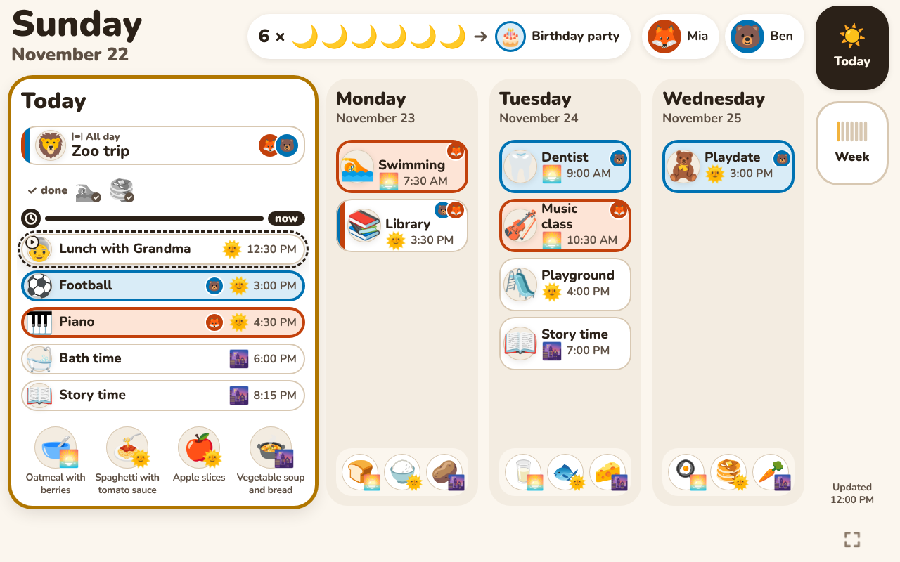        | 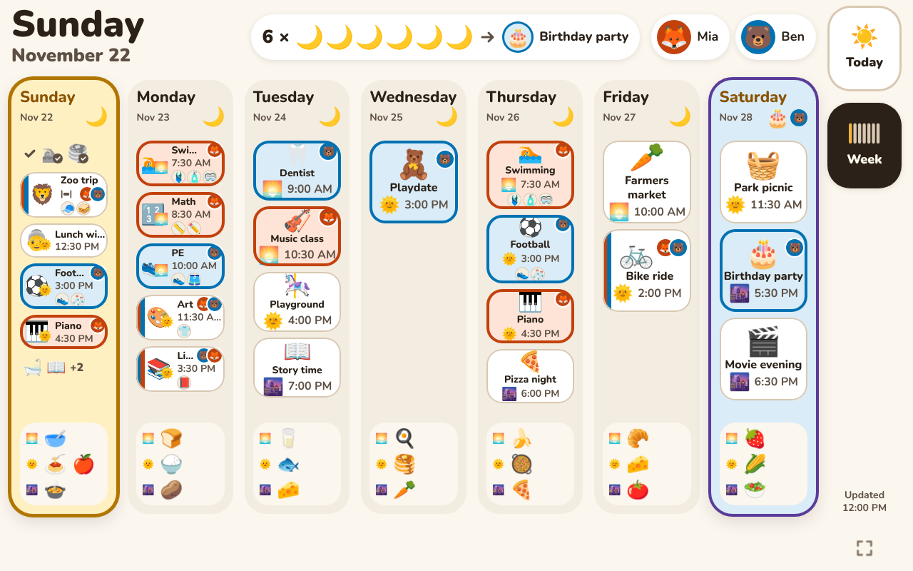        |
| 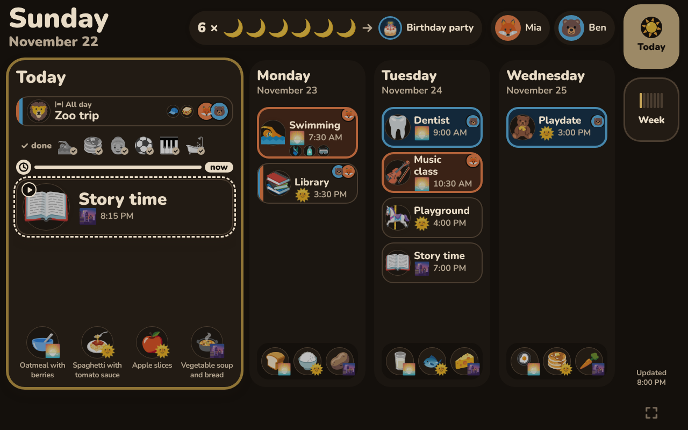 | 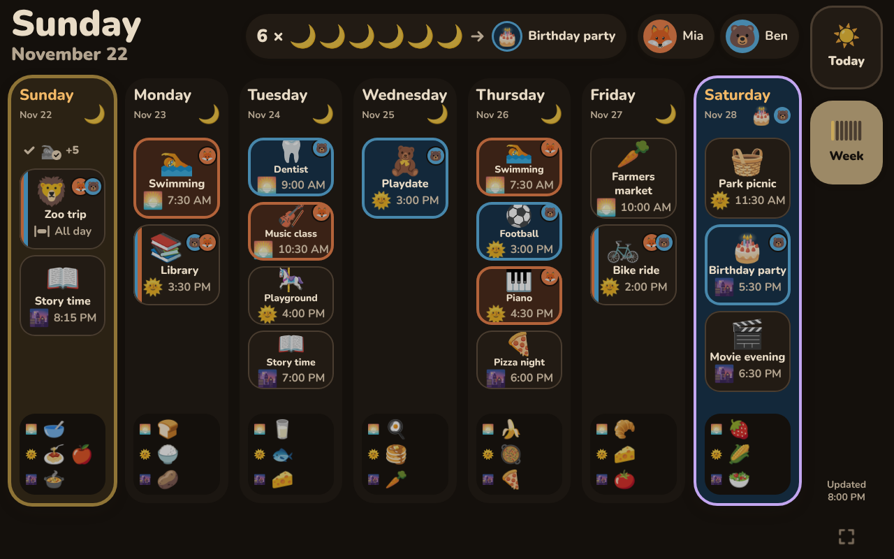 |

The "How many sleeps?" countdown turns into a party popper on the big day:

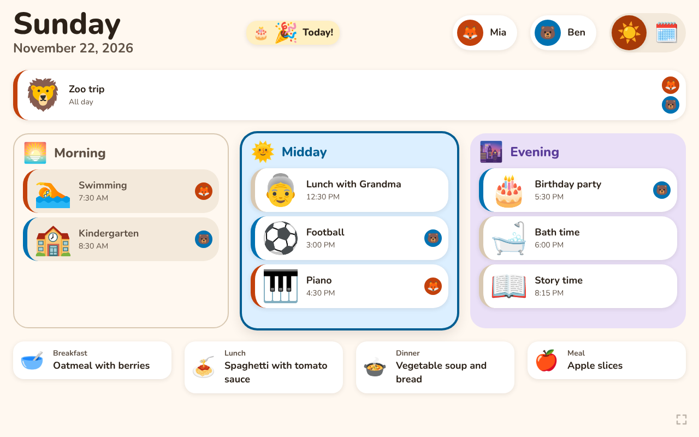

| 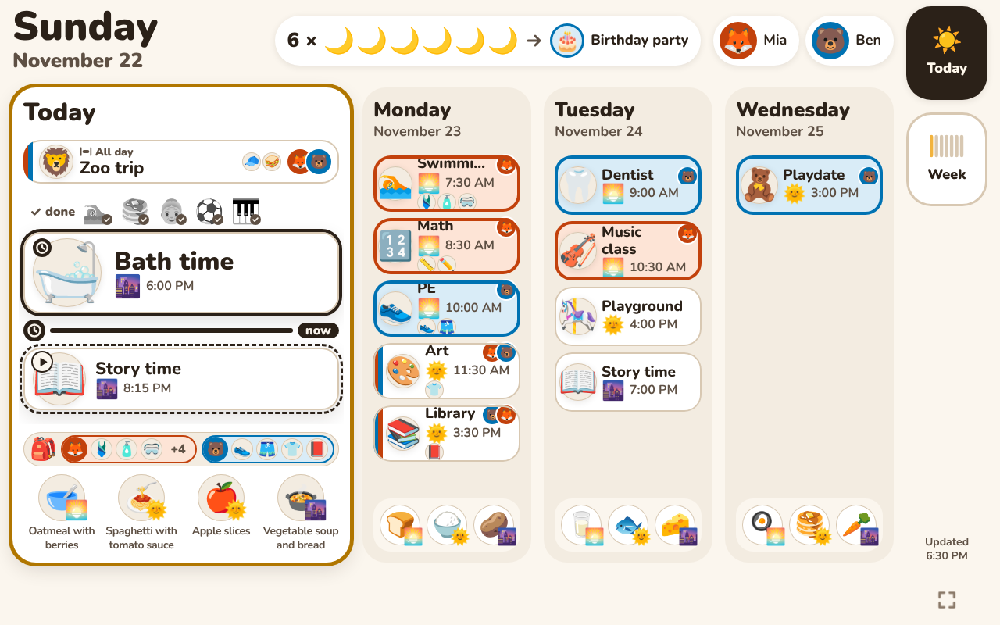 | 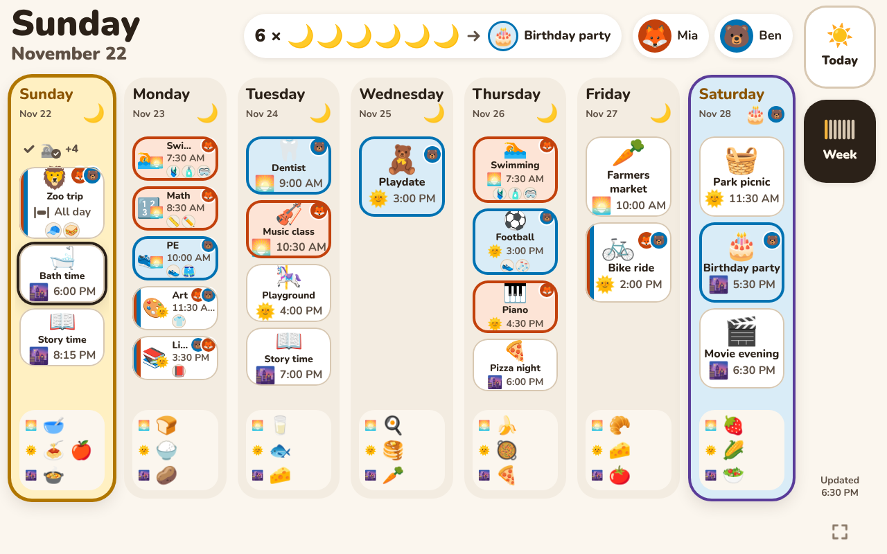 |
| ----------------------------------------------------------------------------------------------------------- | ------------------------------------------------------------------------------------------ |

States:

| Empty day                                                             | Loading                                                       |
| --------------------------------------------------------------------- | ------------------------------------------------------------- |
| 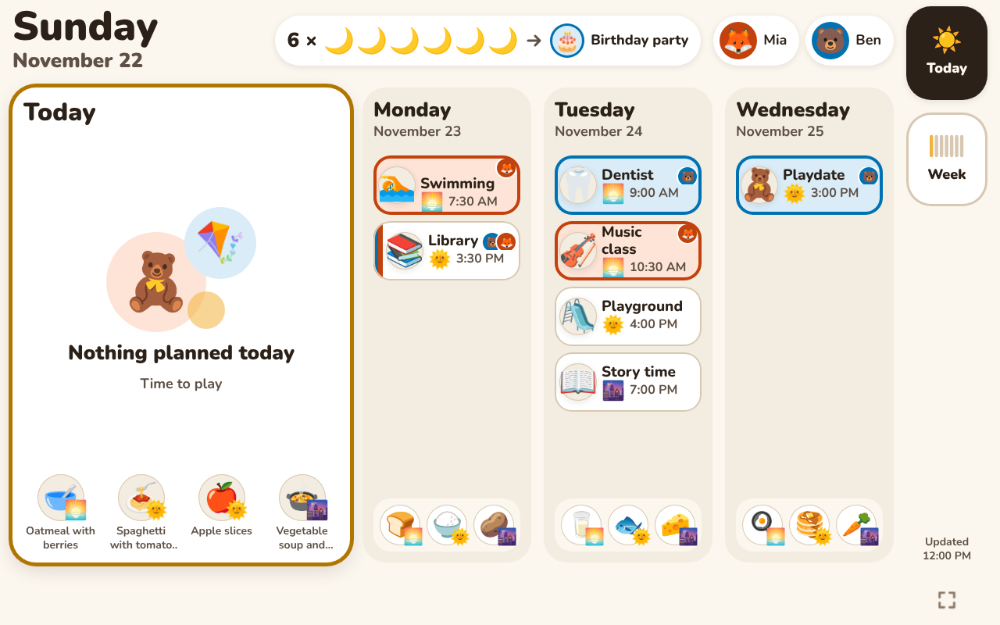 | 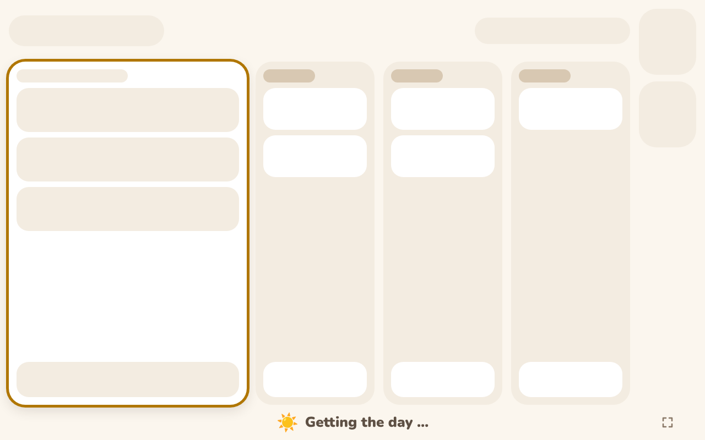 |

| Offline (last good plan, with a note)                         | Error (with an error code for parents)                    |
| ------------------------------------------------------------- | --------------------------------------------------------- |
| 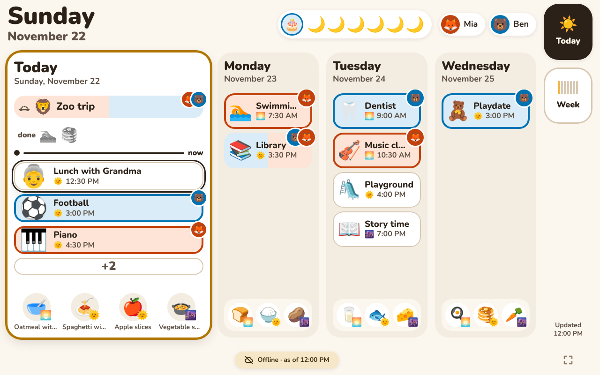 | 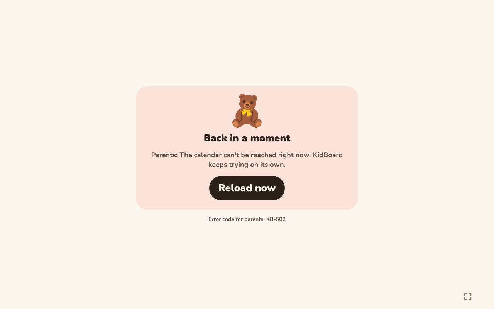 |

## Google Calendar setup

1. **Create separate calendars** in Google Calendar (web, not the phone app): left side,
   "Other calendars" > "+" > "Create new calendar". A good start is one calendar for
   everything the children do (for example "Kids") and one for meals (for example "Meals").
   You can also create one calendar per child; then every event in it belongs to that child
   without a name in the title.
2. **Find the secret address:** Settings (gear) > under "Settings for my calendars" pick the
   calendar > "Integrate calendar" > **Secret address in iCal format**. Copy it. It starts
   with `https://calendar.google.com/calendar/ical/...` and ends with `basic.ics`. Do not use
   the "Public address".
3. **Store it as a secret:** per calendar one Worker secret `CAL_<ID>_URL`, where `<ID>` is
   the calendar `id` from your settings in upper case (`kids` -> `CAL_KIDS_URL`). See
   [Deploy](#deploy) and [docs/CONFIG.md](docs/CONFIG.md).
4. **Create events as usual.** Recurring events, all-day and multi-day events work. Give them
   titles as described in the next section.

Good to know:

- **The secret link is a password.** Anyone who has it can read the whole calendar. Never
  put it into the repository, a chat, a screenshot or an issue. If it leaks, reset it in the
  same Google settings page ("Reset secret address") and update the Worker secret.
- **Sharing:** you do not need to share the calendar with anyone for KidBoard; the secret
  link is enough. For other adults, share the calendar the normal way with their Google
  account, so you never have to hand out the link.
- **Private details end up on the board.** Whatever is in the title of an event is shown on
  the wall. Keep sensitive things out of titles. Descriptions stay on the server; only the
  emoji of a bring line (see [Bring list](#bring-list)) are used.
- Google may take a while (minutes up to a few hours) to reflect edits in the iCal feed, and
  KidBoard caches feeds (default one hour, `KIDBOARD_CACHE_TTL`). A new event therefore does
  not show up instantly.

## Calendar title conventions

The title is the only interface: write it, KidBoard turns it into a picture.

- **Emoji = the picture.** An emoji at the start of the title becomes the icon, and the rest
  is the title: `⚽ Football`. Emoji with skin tones, flags and family sequences work too.
  Any single emoji counts, there is no fixed list.
- **No emoji:** KidBoard looks for a known word (German and English, e.g. Kita, Zahnarzt,
  dentist, swimming, birthday, piano) and uses a matching icon. If nothing matches, events
  get 📅 and meals get 🍽️. Prefer an explicit emoji; it is always right.
- **Children:** put the name(s) in front, followed by a colon: `Mia: 🩰 Ballet`. Several
  children with a comma, `+`, `&`, "und" or "and": `Mia, Ben: 🛁 Bath`. `All:` / `Alle:` /
  `Everyone:` means all children. Names must match a configured child (upper/lower case does
  not matter); anything else before a colon stays part of the title (`Tip: bring a hat`).
  Without a name, an event belongs to the child of its calendar, or to everyone if the
  calendar is not tied to a child.
- **Meals** (meal calendar only): start with a slot word and a colon. Breakfast:
  `Frühstück:` / `Breakfast:`. Lunch: `Mittag:` / `Mittagessen:` / `Lunch:`. Dinner:
  `Abend:` / `Abendessen:` / `Dinner:`. Without a slot word, a meal with a start time is
  sorted by that time (before `bands.middayStart`: breakfast, before `bands.eveningStart`:
  lunch, later: dinner, see [docs/CONFIG.md](docs/CONFIG.md)); an all-day meal is shown as an
  unspecific meal.
- **Order:** child name, meal slot and emoji may come in any order, but each only once and
  before the title text: `Mia: 🩰 Ballet` and `🩰 Mia: Ballet` are the same.
- **Countdown:** events whose icon is in the countdown list (default 🎂 🎉 🎁 🎄 🐣 ✈️ 🏖️) get
  the "How many sleeps?" countdown. For any other event, write `#countdown` in the event's
  description (not the title).
- Titles are plain text: formatting or HTML is shown as typed, never interpreted.

| Raw event title (calendar)     | Icon          | Title            | Children | Meal slot             |
| ------------------------------ | ------------- | ---------------- | -------- | --------------------- |
| `⚽ Football` (Ben's calendar) | ⚽            | Football         | Ben      | -                     |
| `Mia: 🩰 Ballet`               | 🩰            | Ballet           | Mia      | -                     |
| `Mia, Ben: 🛁 Bath`            | 🛁            | Bath             | Mia, Ben | -                     |
| `All: 🌳 Zoo trip`             | 🌳            | Zoo trip         | everyone | -                     |
| `🏫 Kita` (Kids)               | 🏫            | Kita             | everyone | -                     |
| `Dentist`                      | 🦷 (fallback) | Dentist          | everyone | -                     |
| `Mia: Art club`                | 🎨 (fallback) | Art club         | Mia      | -                     |
| `Mia: Swimming lessons`        | 🏊 (fallback) | Swimming lessons | Mia      | -                     |
| `Math` (Kids)                  | 🔢 (fallback) | Math             | everyone | -                     |
| `Tip: bring a hat`             | 📅 (fallback) | Tip: bring a hat | everyone | -                     |
| `🎂 Anna's birthday`           | 🎂            | Anna's birthday  | everyone | - (countdown)         |
| `Lunch: 🍝 Spaghetti` (Meals)  | 🍝            | Spaghetti        | -        | lunch                 |
| `Dinner: Pizza` (Meals)        | 🍕 (fallback) | Pizza            | -        | dinner                |
| `🥣 Muesli` (Meals)            | 🥣            | Muesli           | -        | unspecified (all-day) |

School subjects get an icon without an emoji in the title: Art 🎨, PE/Sport 👟, Music 🎵,
Math 🔢, German/English 📖, Science 🔬, Crafts 🔨, Swimming lessons 🏊 (German names work too,
e.g. `Kunst`, `Mathe`, `Sachkunde`, `Werken`). An emoji in the title always wins. The 🎒 is
never a fallback icon: it only marks the bring area (see [Bring list](#bring-list)).

German works the same: `Mittag: 🍝 Spaghetti`, `Mia: Ballett`. Full rules:
[docs/ARCHITECTURE.md](docs/ARCHITECTURE.md#title-conventions-parsing-rules).

## Bring list

Children should know what to pack: PE kit, swimsuit, paint shirt. Write it into the
**description** of the event in Google Calendar, on a line of its own that starts with
`Bring:` (German `Mitbringen:` works too, upper/lower case does not matter):

```text
Bring: 👟 🩱 🧴
```

- **Phone (Google Calendar app) and web:** open the event, edit it, and put the line into the
  "Add description" field (web: the description box below the time). A bullet in front
  (`- Bring: 👟`) is fine, and so is formatted text.
- **Only the emoji count.** Text next to them is allowed (`Bring: 👟 sports shoes, 🩱`) but
  never shown: the board is for children who cannot read. Duplicates are dropped, at most 8
  icons per event. Several `Bring:` lines are merged. A line like `Please bring: 👟` is not
  a bring line, because the line has to start with the keyword and a colon.
- **Everything else in the description stays private.** The server reads the description,
  keeps only the emoji of the bring line and sends nothing else to the tablet: no other text,
  phone number or address ever leaves the server, not even into the offline copy. Meals
  ignore bring lines.
- **On the tile:** the emoji appear as small chips on the event's tile (overview and week
  view) until the event is over.
- **The 🎒 area:** from the evening before, as soon as the evening begins
  (`bands.eveningStart`, default 17:00, see [docs/CONFIG.md](docs/CONFIG.md)), today's card
  shows a 🎒 area with the icons of tomorrow's events, one row per child (events for everyone
  first); beside the 🎒 it shows an arrow, tomorrow's short weekday and "Tomorrow", so it
  does not look like the morning. After midnight it says "Today" and every event's icons
  disappear when that event starts. The area uses up to one row per child; the events above it
  fold or shrink to make room, while now and next always stay visible. For all-day events (for example a school day without a start
  time) the icons stay until midday (`bands.middayStart`, default 11:00). When nothing is
  left to pack the area disappears. It is only shown in today's column of the overview, not
  in the week view.
- **Weekly subjects:** create the lesson as a recurring event (for example every Tuesday
  `Mia: 🏊 Swimming lessons`) and put the bring line into the description once; it applies to
  every occurrence. For one single day choose "This event" when saving and write a different
  line (or none) for it. Holidays: delete only that single occurrence ("This event"), then
  nothing is shown and nothing has to be packed that day.
- **Delay:** new descriptions show up after Google updates the feed and KidBoard's cache
  expires (up to `KIDBOARD_CACHE_TTL`, default one hour).

## Configuration

Settings live in one JSON document (`KIDBOARD_CONFIG`); the iCal URLs and the optional
access token are Worker secrets. Every option, the secrets and the tablet token flow
(`/?key=`) are described in [docs/CONFIG.md](docs/CONFIG.md). Templates:
[config.example.json](config.example.json) and [.dev.vars.example](.dev.vars.example).

## Deploy

KidBoard is deployed to **Cloudflare Workers** (the free plan is enough). Other hosts are not
supported at the moment (Vercel is tracked in
[issue #3](https://github.com/FinkeFlo/kidboard/issues/3)).

[](https://deploy.workers.cloudflare.com/?url=https://github.com/FinkeFlo/kidboard)

The button copies this repository into your GitHub/GitLab account, builds it with Workers
Builds (`pnpm`, web app before worker) and deploys one Worker that serves the board and the
API. It asks for three secrets (`KIDBOARD_ACCESS_TOKEN`, `KIDBOARD_PARENT_PIN`,
`KIDBOARD_CONFIG` with your children) and creates the KV cache and the D1 database by
itself. Replace every `REPLACE_ME`. Google calendars are optional: add them later as
`calendars` in `KIDBOARD_CONFIG` plus one `CAL_<ID>_URL` secret each.

From a local clone instead:

```sh
pnpm install
pnpm exec wrangler login
pnpm exec wrangler secret put KIDBOARD_ACCESS_TOKEN
pnpm exec wrangler secret put KIDBOARD_PARENT_PIN
pnpm exec wrangler secret put KIDBOARD_CONFIG
pnpm exec wrangler secret put CAL_KINDER_URL   # optional, one per calendar: CAL_<ID>_URL
pnpm deploy:cloudflare                          # builds web + deploys the worker
```

Then open `https://<your-worker>.workers.dev/?key=<token>` once on the tablet. Step by step,
all variables, custom domain, logs and troubleshooting: [docs/DEPLOY.md](docs/DEPLOY.md).

## Kiosk tips

**Fully Kiosk Browser (Android).** Set the start URL to your board address (with `?key=` once,
see [docs/CONFIG.md](docs/CONFIG.md#access-token-the-tablet-link)). Useful settings, names
vary slightly by version: keep the screen on, enable kiosk mode / fullscreen, reload on
network reconnect, and restart the app after a crash. Leave "clear cache/data on start"
off, otherwise the stored token and the offline plan are lost.

**Emoji support (Android 11 or newer).** KidBoard draws the emoji of the tablet itself. Every
icon the app brings along (fallback icons, 🎒, the default countdown icons) is Emoji 13.0 or
older, which Android 11 (2020) and newer show completely. Emoji that you type yourself in
titles and bring lists are shown as they are: a very new emoji may appear as an empty box on
an older tablet, so on a tablet with Android 10 or older prefer classic emoji.

**Installed PWA.** In Chrome open the board and choose "Install app" / "Add to Home screen".
The installed app runs fullscreen without browser bars and keeps working offline with the
last good plan. Open the link with `?key=` once inside the installed app (or first in the
browser, then install).

**Screen dimming and night mode.** Between `nightMode.start` and `nightMode.end` (default
19:30-06:30, in your time zone) the board switches to a dark, low-contrast theme. It does
not switch the screen off. If the room gets too bright anyway, lower the tablet brightness or
let the tablet's own schedule dim it. The board also moves by a few pixels every few minutes
to protect the display from burn-in; this is intended.

**Fullscreen control.** Under the navigation rail, centred, there is a small quiet
fullscreen symbol. Press and hold it for a moment to switch fullscreen on or off, so children
cannot trigger it by accident. It is hidden when fullscreen is unavailable or the board runs
as an installed app.

**Keeping the screen awake.** KidBoard asks the browser for a screen wake lock while the page
is visible and asks again whenever the browser lets go of it. This has limits: Android may
refuse it in battery saver mode or at low charge, and some browsers or older devices do not
support it at all. For a reliable wall tablet also enable "keep screen on" in Fully Kiosk (or
the tablet's developer option "Stay awake while charging") and keep the tablet plugged in.

**"Updated" in the rail.** Under the buttons the rail shows "Updated 12:00" (German:
"Stand 12:00"): the time of the last successful refresh. If it is far behind, see
[Troubleshooting](#troubleshooting). The board refreshes itself (`refreshMinutes`, default 60) and returns from the week view to the overview after `autoReturnSeconds` (default 120).

**Developer note.** Two URL parameters help with testing, they are read once and never
stored: `?night=1` forces night mode (`?night=0` forces day), `?burnin=0` ... `?burnin=7`
pins the burn-in shift to one of eight positions instead of following the clock.

## Troubleshooting

| What you see                                                 | What to do                                                                                                                                                                                                                                                                                                                                                                                     |
| ------------------------------------------------------------ | ---------------------------------------------------------------------------------------------------------------------------------------------------------------------------------------------------------------------------------------------------------------------------------------------------------------------------------------------------------------------------------------------- |
| "This tablet needs a new access link" (**KB-401**)           | The access token is missing, wrong or was changed. Open the tablet link with `?key=<token>` once more.                                                                                                                                                                                                                                                                                         |
| "Offline · as of ..." (**KB-OFF** if there is no saved plan) | No internet. The last good plan stays visible; the board reloads by itself when the network is back.                                                                                                                                                                                                                                                                                           |
| "Can't update · as of ..."                                   | The tablet cannot reach the server; the last good plan stays. Check Wi-Fi and the server, it retries by itself.                                                                                                                                                                                                                                                                                |
| "Maybe not current · as of ..."                              | The server could not reach Google and shows the last good copy (up to 7 days). Check the calendar link, see below.                                                                                                                                                                                                                                                                             |
| "Back in a moment" with an error code                        | A reload usually fixes it ("Reload now"). The code tells a helper what happened, see the list below.                                                                                                                                                                                                                                                                                           |
| Wrong day, or times shifted by hours                         | Set `timeZone` in `KIDBOARD_CONFIG` (e.g. `Europe/Berlin`). The tablet's own time zone is ignored on purpose.                                                                                                                                                                                                                                                                                  |
| A calendar is empty or missing                               | Is `CAL_<ID>_URL` set and does the `<ID>` match the calendar `id`? Is it the secret iCal address? See DEPLOY.md.                                                                                                                                                                                                                                                                               |
| Bring icons do not show                                      | The line must be on its own, start with `Bring:` or `Mitbringen:` **with the colon**, and contain at least one emoji (text-only symbols are ignored). It belongs in the description, not the title. Then wait: Google and the cache delay changes (up to `KIDBOARD_CACHE_TTL`, default one hour). The 🎒 area appears only from `bands.eveningStart` the day before, and only on today's card. |
| New events do not show                                       | Feeds are cached (default one hour) and Google updates the feed with a delay. Wait, or lower `KIDBOARD_CACHE_TTL`.                                                                                                                                                                                                                                                                             |

Error codes shown on the error card ("Error code for parents"):

| Code      | Meaning                                                                                     |
| --------- | ------------------------------------------------------------------------------------------- |
| `KB-NET`  | The tablet cannot reach the server (Wi-Fi, DNS, server down).                               |
| `KB-TIME` | The server took too long to answer.                                                         |
| `KB-401`  | Access token missing or wrong. Open the tablet link with `?key=` again.                     |
| `KB-400`  | The server rejected the request (for example an outdated app version). Reload the page.     |
| `KB-502`  | No calendar could be loaded (all feeds failed and there is no saved copy). Check the links. |
| `KB-500`  | Server problem, usually missing or invalid `KIDBOARD_CONFIG` or a token still `REPLACE_ME`. |
| `KB-HTTP` | Another unexpected HTTP answer. Check the deployment and its logs.                          |
| `KB-DATA` | The answer had an unexpected format (app and worker versions differ). Redeploy, reload.     |
| `KB-OFF`  | Offline and no plan saved yet.                                                              |
| `KB-UI`   | The display itself failed; KidBoard restarts it on its own.                                 |
| `KB-LOAD` | Loading failed for an unknown reason.                                                       |

More on server-side problems: [docs/DEPLOY.md](docs/DEPLOY.md#9-troubleshooting).

## Privacy

KidBoard has no accounts, no analytics and no third-party trackers. Your calendar data goes
from Google to your own Worker and from there to your own tablet. The secret iCal addresses
stay in the Worker and never reach the browser; titles (and therefore children's names and
appointments) are stored in your Worker's cache for a while (fresh about an hour, last good
copy up to seven days) and in the tablet's local storage for offline use. The tablet access
token is kept in the tablet's local storage and removed from the address bar after first use.
Use the access token, because otherwise anyone who learns your Worker URL can read the
calendar through the API. Of an event's description only the emoji of a `Bring:` line ever leave the server; the rest
of the description is never sent to the tablet, stored in its offline copy or logged. No data
is sent anywhere else.

## Development

Requires Node 22 and pnpm 10.

```sh
pnpm install
pnpm dev            # web (Vite) + worker (wrangler dev)
pnpm lint
pnpm format:check
pnpm typecheck
pnpm test
pnpm build
```

See [CONTRIBUTING.md](CONTRIBUTING.md) and the [architecture](docs/ARCHITECTURE.md).

## License

[MIT](LICENSE) (c) 2026 FinkeFlo
