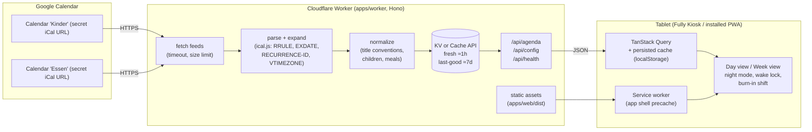

# KidBoard – Architecture

> Engineering docs (plan, ADRs, architecture, progress) are written in English so that
> contributors worldwide can follow them. User-facing docs (README, CONTRIBUTING) are
> bilingual (EN + DE). See [ADR-0001](adr/0001-stack.md).

## Overview

KidBoard is a read-only, icon-first family calendar and meal plan for a wall-mounted
tablet. Parents keep everything in Google Calendar; KidBoard reads the calendars'
**secret iCal addresses** on the server side, normalizes them, and serves a small JSON
API to a kiosk-friendly PWA.



* iCal URLs are **Worker secrets** (`CAL_<ID>_URL`). They never reach the client bundle,
  logs or fixtures.
* Non-secret settings (children, colors, locale, time zone, day bands, night mode) live
  in one JSON document (`KIDBOARD_CONFIG` variable, shape documented in
  `config.example.json`). The worker validates it and exposes the public part at
  `/api/config`.
* One deployable unit: a single Worker serves the SPA as static assets and handles
  `/api/*` first (`run_worker_first`). See [ADR-0002](adr/0002-hosting.md) and
  [Deploy & static headers](#deploy--static-headers-t-25).

## Repository layout

```
apps/
  web/        Vite + React PWA (UI only, talks to /api)
  worker/     Cloudflare Worker (Hono): feeds → JSON API, serves web/dist
packages/
  shared/     Pure TypeScript: data model, config schema, title parser,
              date helpers. No DOM, no Worker globals. Used by both apps.
docs/         Plan, ADRs, architecture, progress, design hand-off
wrangler.jsonc       The only Wrangler config (root: Deploy button + Workers Builds)
.dev.vars.example    Worker secrets template (local `.dev.vars` lives next to it)
```

## Data model (TypeScript)

```ts
/** A configured child. Color is a design-token name or a CSS color. */
export interface Child {
  id: string;            // slug, e.g. "mia"
  name: string;          // "Mia" – also the title prefix "Mia: …"
  color: string;         // e.g. "#E4572E" or token "child-1"
  avatar: string;        // emoji, e.g. "🦊"
}

export type CalendarKind = 'events' | 'meals';

/** One configured iCal feed. The URL itself is a secret and never part of this type. */
export interface CalendarSource {
  id: string;            // "kinder", "essen", "mia" … → secret CAL_<ID>_URL
  kind: CalendarKind;
  childId?: string;      // feed belongs to exactly one child (one calendar per child)
  label?: string;
}

export type MealSlot = 'breakfast' | 'lunch' | 'dinner' | 'unspecified';

/** One concrete occurrence (recurrences are already expanded server-side). */
export interface CalendarEvent {
  id: string;            // stable: `${sourceId}:${uid}:${recurrenceId}` hashed
  sourceId: string;
  title: string;         // display title, emoji and prefixes stripped, plain text
  icon: string;          // leading emoji, or fallback icon
  iconIsFallback: boolean;
  childIds: string[];    // [] = for everyone
  allDay: boolean;
  start: string;         // ISO 8601 with offset (timed) or YYYY-MM-DD (all-day)
  end: string;           // exclusive end, same format as start
  countdown: boolean;    // special event for the "how many sleeps?" countdown
}

export interface Meal {
  id: string;
  sourceId: string;
  date: string;          // YYYY-MM-DD in the configured time zone
  slot: MealSlot;
  title: string;
  icon: string;
  iconIsFallback: boolean;
}

export interface AgendaResponse {
  generatedAt: string;   // ISO timestamp of the underlying data
  timeZone: string;      // e.g. "Europe/Berlin"
  range: { from: string; to: string };  // YYYY-MM-DD, `to` exclusive
  stale: boolean;        // true = at least one source served from last-good cache
  sources: Array<{
    id: string;
    status: 'ok' | 'stale' | 'error';
    fetchedAt?: string;  // when the served data was fetched (absent for 'error')
    truncated?: boolean; // true = recurrence expansion hit a cap (ADR-0003)
  }>;
  events: CalendarEvent[];
  meals: Meal[];
}
```

## Title conventions (parsing rules)

Parsing happens server-side in `packages/shared` (pure function, heavily unit-tested).
Order of operations on the raw `SUMMARY`:

1. Trim; collapse inner whitespace. Treat as **plain text** (never HTML).
2. **Child prefix** – `Name: rest` where `Name` matches a configured child's name
   (case-insensitive, Unicode-aware) or `Alle:` / `All:` / `Everyone:` (= all children).
   Several children: `Mia, Ben: …` or `Mia + Ben: …`. Unknown names are left untouched
   (so `Tipp: …` stays a title).
3. **Meal prefix** (meal calendars only) – `Frühstück:`/`Breakfast:`, `Mittag:`/
   `Mittagessen:`/`Lunch:`, `Abend:`/`Abendessen:`/`Dinner:` (case-insensitive).
   No prefix → `unspecified` slot.
4. **Leading emoji** – the first grapheme cluster, if it is an RGI emoji (incl. ZWJ
   sequences like 👨‍👩‍👧, skin tones like 👋🏽, flags, keycaps), becomes `icon`.
   Detection uses `emoji-regex` on the first `Intl.Segmenter` grapheme.
5. **Fallback icon** – if no emoji: keyword table (DE + EN, e.g. "Kita"→🏫,
   "Geburtstag"/"birthday"→🎂, "Arzt"/"doctor"→🩺), else 📅 for events and 🍽️ for meals.
6. **Countdown flag** – `true` if the icon is in `config.countdown.emojis`
   (default 🎂 🎉 🎁 🎄 🐣 ✈️ 🏖️) or the event description contains `#countdown`.

| Raw `SUMMARY` (calendar) | icon | title | children | slot |
|---|---|---|---|---|
| `⚽ Fußball` (Ben's calendar) | ⚽ | Fußball | ben | – |
| `Mia: 🩰 Ballett` | 🩰 | Ballett | mia | – |
| `Mia, Ben: 🛁 Baden` | 🛁 | Baden | mia, ben | – |
| `🏫 Kita` (Kinder) | 🏫 | Kita | (all) | – |
| `Zahnarzt` | 🦷 (fallback) | Zahnarzt | (all) | – |
| `Mittag: 🍝 Spaghetti` (Essen) | 🍝 | Spaghetti | – | lunch |
| `Dinner: Pizza` (Essen) | 🍕 (fallback) | Pizza | – | dinner |
| `🥣 Müsli` (Essen) | 🥣 | Müsli | – | unspecified |

## Time handling

* All server-side expansion runs in the configured IANA zone (default `Europe/Berlin`);
  output offsets and the `[from, to)` window are in that zone (details: ADR-0003).
* TZIDs that are IANA zones are converted with the runtime tz database (`@date-fns/tz`
  `tzOffset`), whether or not the feed has a `VTIMEZONE` for them; non-IANA TZIDs use the
  feed's `VTIMEZONE` via ical.js; floating times and unknown TZIDs use the configured
  zone. `VTIMEZONE`s are not registered globally in `ICAL.TimezoneService`.
* DST: non-existent local times (spring-forward gap) use the offset before the gap
  (02:30 → 03:30), ambiguous ones (fall-back) the first occurrence (RFC 5545 §3.3.5).
* Recurrences are fast-forwarded where provably equivalent and capped per series and
  per feed (CPU budget, ADR-0003); a hit cap is reported as `truncated`.
* Day boundaries, bands (morning/midday/evening) and "nights until" are computed with
  `@date-fns/tz` (`TZDate`, `tzOffset`) in the configured zone, not the device zone;
  "nights until" is the calendar-day difference of the date keys (T-19).
* "Today" (`YYYY-MM-DD` in the configured zone) comes from one shared helper,
  `todayInZone` in `packages/shared` (`@date-fns/tz` `tzOffset`), used by the worker
  window and the client's `range.from`, so both always name the same day.
* All-day events use date-only strings with exclusive end, multi-day events appear on
  every covered day.

## Caching & offline (summary – details in [ADR-0006](adr/0006-caching-offline.md))

| Layer | What | Lifetime |
|---|---|---|
| Worker KV (or Cache API) "fresh" | normalized per-source result for the window | ~1 h (configurable) |
| Worker KV (or Cache API) "last-good" | same entry, after the TTL | ~7 days |
| Service worker (Workbox precache) | app shell, fonts, icons | until next deploy |
| TanStack Query persisted cache | last `/api/agenda` + `/api/config` | 7 days |

The client refetches every `refreshMinutes` (default hourly), on `visibilitychange`/`online`,
and after midnight (new day = new agenda query key, seeded from the cache meanwhile, T-16).

### PWA / service worker (T-14)

`vite-plugin-pwa` (`generateSW`, `registerType: 'autoUpdate'`), options in
`apps/web/pwa/options.ts`. The Workbox precache holds HTML, JS, CSS, the Nunito `woff2`
files and the icons; every navigation outside `/api/*` is answered with the precached
`index.html` (`navigateFallbackDenylist: [/^\/api\//]`), so the shell loads offline after
the first visit. `/api/*` is `NetworkOnly`: no API response and no request carrying the
bearer token ever enters Cache Storage. Manifest: `display: fullscreen`, `orientation:
landscape`, `theme_color` = `--color-accent`, `background_color` = `--color-surface`
(read from `tokens.css` at build time). Icons (any + maskable + Apple + favicon) are
generated on every build by `@vite-pwa/assets-generator` from the original artwork
`apps/web/public/kidboard-icon.svg` (`apps/web/pwa-assets.config.ts`). The app polls for a
new `sw.js` hourly; a new worker activates at once and the page reloads by itself.

### Night mode (T-21)

`apps/web/src/theme/`: `isNight(instant, nightMode, zone)` (pure) is true in
`[start, end)` of the wall clock of the config zone; `end` before `start` spans midnight
(19:30-06:30), `enabled: false` is never night. Wall-clock minutes mean a DST night
follows the clock face (skipped hour never matches, repeated hour matches twice).
`useNightTheme(nightMode, zone)` (called by `Board`) recomputes it on the minute clock
(`useNow`) and sets `<html data-theme="night|light">`, which swaps the colour/shadow
variables in `tokens.css`; Tailwind's `night:` variant matches the same attribute. Until
the config is known the theme is left untouched, and the first known value applies
without a fade. **Before first paint** a classic inline script in `index.html` re-applies
the last theme the board applied (`localStorage` `kidboard.theme`, written by
`rememberTheme` whenever the clock's theme is applied), so a cold start at night (config
not yet known, or failing from the start) shows the skeleton or error screen in night
tokens instead of a bright screen. Missing or blocked storage falls back to light tokens.
The script needs no network. The production CSP allows exactly this script by its
SHA-256 hash, computed from the built `index.html` when `dist/_headers` is generated
(see [Deploy & static headers](#deploy--static-headers-t-25)). While the theme changes the hook sets
`data-theme-switching` on `<html>` for 0.8 s, during which `global.css` fades the colours
over `--duration-slow` (variables do not animate on their own); under
`prefers-reduced-motion` the durations are 0 and the switch is instant. `?night=1|0`
forces night/day for testing; it is read once at startup and deliberately **not**
persisted, neither as a parameter nor as the remembered theme (a forgotten test link must
not pin a kiosk after the next clean reload).
`<meta name="theme-color">` is updated at runtime to `--color-surface` in night mode and
restored to the build-time value (brand accent) by day. The manifest `theme_color` stays
static, because a manifest cannot change with the time of day; it only applies at
install/splash time.

### Kiosk: wake lock, fullscreen, boundary reset (T-20)

`apps/web/src/kiosk/`: `useWakeLock()` requests the Screen Wake Lock while the page is
visible and re-requests from the sentinel's `release` event (system release while still
visible; a kiosk rarely sees `visibilitychange`), on `visibilitychange` and on `focus`. A
rejected request (low battery, policy) is retried by a single timer (10 s, doubling, max
2 min; cleared on success and unmount); a missing API is a silent no-op. `useFullscreen()` wraps the Fullscreen API (`fullscreenchange`) and
reports `available: false` where unsupported or when the board already runs as an installed
app (`display-mode: standalone|fullscreen` without an active fullscreen element).
`FullscreenControl` is a fixed bottom-right corner overlay. `BoardFrame` reserves the
bottom strip for it (`pb-touch`, 64 px), so it never covers content; burn-in shifts (T-22)
stay inside that gutter: faint glyph, 64 px hit area, **long press (700 ms)** for
pointers so children cannot trigger it by accident; the request runs on pointer-up
(user gesture); keyboard/assistive-tech clicks act at once.
`AppErrorBoundary` resets itself after 5 s, doubling per failed retry up to 5 min; the
backoff starts over when the children ran 60 s without failing. The retry button resets
at once.

### Burn-in protection & banner slot (T-22)

`apps/web/src/burnin/`: `burnInOffset(stepIndex)` (pure) walks an 8-point square ring
(`BURN_IN_ORBIT`, units of `--spacing-burn-in` = 0.5 rem, i.e. 8 px at 1280x800 and 12 px at
2000x1200; the corners are the maximum shift); `burnInStepIndex(now)` = `floor(epoch /
5 min)`, so every device follows the same deterministic schedule (a full orbit takes 40 min).
`useBurnInShift()` reads it on the minute clock (`useNow`, no timer of its own).
`BoardFrame` applies it as a `transform` on an **inner wrapper** (`data-testid=burn-in-shift`),
never on `<main>`: `<main>` gives `burn-in` of its gutter back as the wrapper's padding, and
its bottom strip is `touch + burn-in` tall, so the shifted wrapper stays inside the original
gutter and above the fullscreen strip (amplitude 0.5 rem < gutter 1.5 rem; unit-tested
against the tokens). The step glides over `--duration-slow`; under `prefers-reduced-motion`
the durations are 0 (also `motion-reduce:transition-none`), so it jumps without animation.
`transform` is part of the `data-theme-switching` transition list (T-21), so a step that
coincides with the night switch (19:30/06:30 are step boundaries) does not jump.
Test hook: `?burnin=0..7` pins an orbit index (1, 3, 5, 7 = corners = max shift); read once,
not persisted. **Not shifted:** the fullscreen control (faint, fixed 64 px target in the
reserved corner: a stable target matters more than its negligible burn-in risk) and the
loading/error screens (transient, no board chrome).

The offline/stale banner no longer lives in the header: it has a fixed slot in the reserved
bottom strip, centred left of the fullscreen control (`inset-x-touch`). Appearing or
disappearing never reflows the header, so the view toggle keeps its place (e2e checks identical
toggle positions with and without banner, both views and viewports).

### Client data layer (T-13)

`apps/web/src/data/`: typed API client (zod-validated, 15 s timeout > worker's ~11 s
upstream budget, Bearer token from a one-time `?key=`), TanStack Query with the
localStorage persister, `useConfig()`, `useAgenda({ from, days })` and
`useConnectionStatus()` → `loading | ready | offline | stale | error`. A 502 or an
invalid response never replaces shown or persisted data; with data it shows as `stale`,
without data as `error`. A 200 agenda that is worker-stale or has a failed source is
`stale` too. A 401 wipes all calendar data (memory and storage) and the stored token:
status `error`, `useApiErrorKind()` = `unauthorized`. Persisted queries older than 7 days
are dropped, and so are agendas superseded by a later-fetched one that reaches at least
as far (T-19, ADR-0006). The config `locale` is applied to i18n as soon as the config is
known (fetched or restored). Rules in detail: [ADR-0006](adr/0006-caching-offline.md).

### Clock & day rollover (T-16)

`apps/web/src/time/`: pure logic in `clock.ts` (`startOfMinute`, `msUntilNextMinute`,
`minuteOfDay`, `bandOf(instant, bands, zone)` → `night | morning | midday | evening`,
boundaries belong to the later band, `night` = before `morningStart`; the day model
calls it directly with the minute-clock `now`, there is no band hook), hooks in
`hooks.ts`:

* `useNow()`: current time floored to the minute. One shared `setTimeout` chain
  (`minuteClock.ts`) wakes all consumers at each minute boundary; every delay is
  computed afresh from `Date.now()` (late or throttled timers and system clock jumps
  correct themselves at the next firing, nothing is accumulated). `visibilitychange`
  (visible) and `pageshow` wake it at once, so a tab that slept across midnight shows
  the new day immediately. The timer and listeners exist only while something is
  subscribed.
* `useToday(zone)`: `todayInZone(Date.now(), zone)`; changes exactly at local midnight
  of the config zone (minute boundaries are local minute boundaries for all
  whole-minute offsets), also on DST nights and when the DST change happens at midnight,
  whatever the device zone. Re-renders only when the date changes.

**Before the config has loaded** the time zone is unknown. KidBoard deliberately gates
instead of guessing a default zone: `useToday` returns `undefined`,
`useTodayAgenda` sends no agenda request (its agenda query stays pending, so the
connection status is `loading`, or `offline` without network), and views show their
loading state. A default such as `Europe/Berlin` would fetch and show the wrong day for
families in other zones and then jump. In practice the gate only applies to the very
first visit (or after 7 days without data): the persisted config is restored at
startup, also offline.

**Rollover:** `useTodayAgenda(days = AGENDA_DAYS)` (31: today plus the 30 days the
countdown looks ahead, T-19; day, week and countdown share this one query, its status
and its offline seed) = config zone → `useToday` → `useAgenda({ from:
today, days })`. At midnight the new `from` is a new query key, fetched at once. Until
that succeeds the new query is seeded (TanStack `initialData`, `initialDataUpdatedAt: 0`)
from the most recent cached agenda whose range covers the new day, re-scoped to the new
range (`agendaSeed.ts`; same overlap rules as the worker; `range.to` never claims days
the cache does not cover). Only real responses younger than 7 days qualify (the
persister's max-age rule, applied to in-memory data too; seeds never qualify), so over
several offline days each day is seeded from the last real response while it covers
the day. So offline or after a 502 the board keeps showing the last state with status
`offline`/`stale`, never empty or `loading`. A seed is never `ready`: an agenda query
whose data is a seed (`dataUpdatedAt` 0) or ends before `from + days` (from the query
key) counts as `stale` until the real response lands, also while that fetch is still
running online (both rules on purpose: even a seed that covers every requested day is
the last known state, not an answer for the new range). For one render right at the
rollover the status can still show the previous value, until the new query's observer
has subscribed. `initialData` rather than
`placeholderData`: placeholder data disappears once the fetch fails and is invisible to
the cache-based connection status. The seed is marked outdated (`dataUpdatedAt` 0), so it
is refetched regardless of `staleTime` and never persisted (the persister's per-query
7-day check drops it); a 401 wipes it like all agenda data. `useAgenda` waits for the
persisted cache to be restored before it creates the real query, so a reload on a later
day (offline) is seeded from the restored agenda.

### Day view (T-17)

`apps/web/src/day/buildDayModel.ts` (pure, `buildDayModel(agenda, config, date, now)`)
decides what belongs to a date (a date key in the config zone) and where it goes; every
instant is read in the config zone, never the device zone. **Placement rules:**

* **All-day events** (also multi-day ones) covering the date go to the top row, in feed
  order. `end` is exclusive; a zero-length all-day event counts for its start day.
* **Timed events** belong to every date from the date of their start to the date of
  their last instant (`end − 1 ms`, so an event ending at midnight does not spill into the
  next day; a zero-length event stays on its start day).
* **Band** by start time (`bandOf`, wall clock of the zone; a boundary belongs to the later
  band): `morning` from `morningStart`, `midday` from `middayStart`, `evening` from
  `eveningStart`. Before `morningStart` (`night`) the event goes to the morning band (the
  board has no night band). An event that started on an earlier day (multi-day,
  crossing midnight) is in the morning band too, with a "continues" hint instead of its
  original start time. Inside a band: by start, ties by title; above 4 events a band
  lists them in two columns.
* **Status** only on today: an event is `past` once its end has passed (zero-length: after
  its start), `current` while running, else `upcoming`; all-day events are always
  `upcoming`. The band containing `now` is `current`, earlier bands `past`; before
  `morningStart` nothing is current or past. Past items recede via surface/text tokens
  (not opacity, WCAG AA).
* **Meals** of the date, ordered breakfast, lunch, dinner, unspecified.

**States:** `DayLoading` (skeleton with the view's layout) until config and agenda are
known; `DayEmpty` ("nothing planned" illustration) inside the board; `DayError` (child-calm
emoji + sentence, parent-readable reason: `failed`, `offline`, `unauthorized`) only when
there is no data at all. With data, offline or stale, the board stays and only the
`DiscreetStatusBanner` in the bottom strip reports it (T-22). **Stale-banner delay:** the
banner shows `stale` only after it has lasted **5 s** (`STALE_BANNER_DELAY_MS`,
`useSettled`), because online every midnight is briefly `stale` (the new day is seeded from
the cache until its fetch lands) and that must not flash on a wall display. `offline`,
`error` and `unauthorized` show at once. E2E (`e2e/offline.spec.ts`) covers the offline
reload through the service worker, `stale: true`, 502 with and without data, reconnect,
offline across midnight and the 401 wipe, with the device in `America/Los_Angeles`.

### Board: day & week view (T-18)

`apps/web/src/board/`: `Board` loads config and agenda, then renders `BoardFrame`
(`<main>`, header with today's date, the countdown (T-19), `DiscreetStatusBanner`, `ChildLegend` and the
pictorial `ViewToggle` ☀️/🗓️) around `DayBoard` or `WeekBoard`. View state is local to
`Board` (day on start). `useAutoReturn` switches back to the day view after
`config.autoReturnSeconds` (default 120) without `pointerdown`/`pointermove`/`touchstart`/
`keydown`; every activity restarts the countdown.

`apps/web/src/week/buildWeekModel.ts` (pure): 7 columns from today in the config zone
(`addCalendarDays`), each built with `buildDayModel(agenda, config, date, now)`, so day
and week agree on what belongs to a day. Meals are part of the columns (no extra
screen, one glance). **Most important events** (they get the 3 icon slots, the rest
becomes "+N"): 0. events already over today rank **last** (the column answers "what is
still to come?"; ranking instead of dimming keeps WCAG AA contrast), 1. `countdown`
events, 2. all-day events, 3. timed events by start (a multi-day event continuing from
an earlier day counts as the earliest), ties by title. An icon of a child's event sits
in a ring in the (first) child's colour with a small avatar per child (colour is never
the only cue); events without a child have no ring.
**One meaning per symbol:** 🌙 only counts sleeps (countdown), ☀️ is the day-view toggle;
the day bands use 🌅 / 🌞 / 🌆.
Weekend = Saturday/Sunday of the date key (zone-independent calendar math).
The week uses the board's one agenda query (`AGENDA_DAYS` = 31 since T-19).

### Countdown "How many sleeps?" (T-19)

`apps/web/src/countdown/`: `buildCountdown(events, today, zone)` (pure) and
`CountdownBadge`. Rules:

* Candidates: events with `countdown: true` whose **start date** (config zone; all-day:
  the date key) is today or up to 30 nights ahead (`COUNTDOWN_MAX_NIGHTS`); the nearest
  wins. Nights = calendar-day difference (`calendarDaysBetween` in `packages/shared`,
  UTC day numbers of the date keys), so 23 h / 25 h DST days still count as one night.
* Today → 0 nights → "today!" state, for the whole start day (also after a timed event
  has ended); tomorrow → 1 🌙.
* **In progress vs. future:** an event that started on an earlier day is under way, not
  awaited. It is skipped and the next upcoming countdown event is shown (a two-week
  holiday does not read "today!" for two weeks).
* **Several countdowns on the same (nearest) day** share one countdown: all of them are
  named in the label (localized list), the badge shows up to 3 of their icons; order:
  all-day first, then start time, then title.
* Rendering: ≤ 14 nights one 🌙 each, in rows of 7 (a week per row); beyond, one 🌙 and
  "×N". Week view: `full` variant in the header; day view: `compact` badge (smaller
  icon, but heading-sized moons) in the same place. Today shows 🎉 next to "Today!". The visuals are `aria-hidden`; a region "How many sleeps?" carries
  a localized label with i18next plurals (`countdown.nights_one/_other`). Static, no
  animation (nothing to reduce for `prefers-reduced-motion`).
* Data: the countdown reads the board's agenda (31 days). After midnight without a new
  response the seed covers 30 days (one day short, status `stale`); the countdown works
  on it and only misses events on the 30th night ahead until the real response lands.

### Demo data & screenshots (T-24)

`apps/web/demo/demoData.ts`: synthetic config and agenda (Mia 🦊 / Ben 🐻) built from
"today" in the config zone (a repeating week of events and meals for 31 days plus one
countdown event), so nothing goes stale. `pnpm dev:demo` serves it from a dev-only Vite
plugin (`--mode demo`, `apply: "serve"`, never in a build). `pnpm screenshots` (own
Playwright config, `apps/web/screenshots/`, after `pnpm build`) mocks the API with the
same data, pins the clock (`fixClock`), `?burnin=0`, `?night=` and reduced motion, and
writes day/week x light/night x 1280x800/2000x1200 PNGs to `docs/screenshots/`; it is
not part of `pnpm test:e2e`. CI runs it in the `screenshots` job and uploads the PNGs.

### Worker API details (T-10)

- **Window:** per source the worker expands and normalizes a fixed rolling window
  `[today − 1, today + 32)` (config zone; 32 days ahead so countdowns up to 30 days
  ahead are covered, T-19) once per TTL and caches the result; `/api/agenda` only
  filters it. `[from, from + days)` must lie inside the window (`days` ≤ 31 – was 14,
  raised to 31 in T-19 –, default 8), otherwise `400`. A 31-day range fits for every
  `from` from `today − 1` to `today + 1` (e.g. `from` = today, `days` = 31 ends at
  `today + 31`); anything reaching past `today + 32` is a `400`. No on-demand expansion outside it (CPU budget, ADR-0003).
- **Storage (ADR-0006):** one JSON entry per source (validated with the shared zod
  schemas on read) under the key `v1/source/<sourceId>/<hash>`, kept 7 days. It is
  *fresh* while it was expanded for the current window and is younger than the TTL, and
  serves as *last-good* otherwise. `<hash>` = SHA-256 (truncated) of the validated
  config, the source id and the feed URL: a config or URL change starts with an empty
  cache; the URL itself never appears in a key, log or response. Backend: Workers KV
  (`KIDBOARD_CACHE`, auto-provisioned) when bound, else the Cache API (synthetic key
  `https://cache.kidboard.invalid/<key>`; only functional on custom domains). A
  per-isolate memory map (≤ 64 entries) sits in front, and concurrent misses in an
  isolate share one upstream fetch (single flight).
- **KV write budget:** one write per source per refresh. With KV the fresh TTL is at
  least `ceil(sources × 86 400 / 500)` s (half of the Free plan's 1 000 writes/day; e.g.
  2 sources → 346 s); a lower `KIDBOARD_CACHE_TTL` is raised with a log warning.
- **Failures:** non-2xx, timeout (10 s, headers and body), > 5 MB (Content-Length and
  streamed byte count), network errors and `FeedParseError` → the stored entry as
  `stale` (an old entry may cover only part of the requested range, e.g. after several
  days offline), else `error`. Logs contain source ids, secret _names_, reason codes
  and expansion warning codes only. Response `200` if any source is `ok`/`stale`, `502`
  otherwise; `generatedAt` = oldest `fetchedAt` served.
- **Security:** optional `KIDBOARD_ACCESS_TOKEN` (Bearer or `?key=`, SHA-256 +
  `crypto.subtle.timingSafeEqual`); a token still containing the template marker
  `REPLACE_ME` fails closed (`500 server_misconfigured`, T-25); `/api/health` is public and returns only
  `{ ok: true }`. CORS only for `KIDBOARD_ALLOWED_ORIGINS` (preflights are answered before
  the token check). Hono `secureHeaders()` (nosniff, `Referrer-Policy: no-referrer`, …) and
  `Cache-Control: no-store` on every API response (the client owns caching, ADR-0006).
- **Config:** `KIDBOARD_CONFIG` is parsed once per isolate (memoized by raw string);
  invalid → `500 { error: "server_misconfigured" }` and a log line with the validation
  errors.

### Deploy & static headers (T-25)

- **Config:** one `wrangler.jsonc` at the repository root (Deploy to Cloudflare and
  Workers Builds read it from the root; `wrangler` in `apps/worker` finds it by searching
  up). `main` = `apps/worker/src/index.ts`, assets = `apps/web/dist`, id-less KV binding,
  `keep_vars: true` (dashboard variables survive deploys), `observability.enabled` with
  `redact_query_string: true` (the API also accepts `?key=`). `pnpm deploy:cloudflare`
  builds the web app and runs `wrangler deploy`; CI runs `wrangler deploy --dry-run`.
  Guide: [docs/DEPLOY.md](DEPLOY.md).
- **Static headers:** Workers Static Assets applies `apps/web/dist/_headers` to asset
  responses (also the SPA fallback), never to Worker responses. The file is generated
  after `vite build` by `apps/web/headers/staticHeaders.ts` from the final
  `dist/index.html`: a CSP (`default-src 'self'`, `script-src 'self'` + the SHA-256 of
  every inline script, i.e. the theme boot script; no `unsafe-inline`/`unsafe-eval`,
  `object-src`/`base-uri`/`form-action 'none'`), `X-Content-Type-Options: nosniff`,
  `Referrer-Policy: no-referrer` and a `Permissions-Policy` without camera, microphone,
  geolocation, payment, usb (wake lock and fullscreen stay allowed). Framing is not
  restricted (wall dashboards may embed the board). Cache-Control is not overridden:
  the platform default `public, max-age=0, must-revalidate` + `ETag` is right for
  `sw.js`, `index.html` and the manifest.
- **CSP compatibility:** zod runs `jitless` (`apps/web/src/zodConfig.ts`, first import of
  `main.tsx`); otherwise its `new Function` probe is reported as a CSP violation.
  `vite preview` sends the same headers, so the whole E2E suite runs under the CSP;
  `e2e/csp.spec.ts` checks the header, the boot script and zero violations (also with
  the service worker).
- **Logs:** a `/?key=` navigation is answered by static asset serving and never invokes
  the Worker, so Workers Logs / Logpush (`workers_trace_events`) do not record it. API
  requests are logged without query string. Details: [docs/DEPLOY.md](DEPLOY.md#logs-and-the-key-link).
