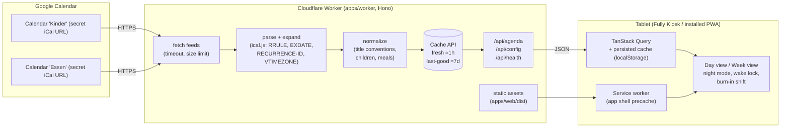

# KidBoard – Architecture

> Engineering docs (plan, ADRs, architecture, progress) are written in English so that
> contributors worldwide can follow them. User-facing docs (README, CONTRIBUTING) are
> bilingual (EN + DE). See [ADR-0001](adr/0001-stack.md).

## Overview

KidBoard is a read-only, icon-first family calendar and meal plan for a wall-mounted
tablet. Parents keep everything in Google Calendar; KidBoard reads the calendars'
**secret iCal addresses** on the server side, normalizes them, and serves a small JSON
API to a kiosk-friendly PWA.



* iCal URLs are **Worker secrets** (`CAL_<ID>_URL`). They never reach the client bundle,
  logs or fixtures.
* Non-secret settings (children, colors, locale, time zone, day bands, night mode) live
  in one JSON document (`KIDBOARD_CONFIG` variable, shape documented in
  `config.example.json`). The worker validates it and exposes the public part at
  `/api/config`.
* One deployable unit: a single Worker serves the SPA as static assets and handles
  `/api/*` first (`run_worker_first`). See [ADR-0002](adr/0002-hosting.md).

## Repository layout

```
apps/
  web/        Vite + React PWA (UI only, talks to /api)
  worker/     Cloudflare Worker (Hono): feeds → JSON API, serves web/dist
packages/
  shared/     Pure TypeScript: data model, config schema, title parser,
              date helpers. No DOM, no Worker globals. Used by both apps.
docs/         Plan, ADRs, architecture, progress, design hand-off
```

## Data model (TypeScript)

```ts
/** A configured child. Color is a design-token name or a CSS color. */
export interface Child {
  id: string;            // slug, e.g. "mia"
  name: string;          // "Mia" – also the title prefix "Mia: …"
  color: string;         // e.g. "#E4572E" or token "child-1"
  avatar: string;        // emoji, e.g. "🦊"
}

export type CalendarKind = 'events' | 'meals';

/** One configured iCal feed. The URL itself is a secret and never part of this type. */
export interface CalendarSource {
  id: string;            // "kinder", "essen", "mia" … → secret CAL_<ID>_URL
  kind: CalendarKind;
  childId?: string;      // feed belongs to exactly one child (one calendar per child)
  label?: string;
}

export type MealSlot = 'breakfast' | 'lunch' | 'dinner' | 'unspecified';

/** One concrete occurrence (recurrences are already expanded server-side). */
export interface CalendarEvent {
  id: string;            // stable: `${sourceId}:${uid}:${recurrenceId}` hashed
  sourceId: string;
  title: string;         // display title, emoji and prefixes stripped, plain text
  icon: string;          // leading emoji, or fallback icon
  iconIsFallback: boolean;
  childIds: string[];    // [] = for everyone
  allDay: boolean;
  start: string;         // ISO 8601 with offset (timed) or YYYY-MM-DD (all-day)
  end: string;           // exclusive end, same format as start
  countdown: boolean;    // special event for the "how many sleeps?" countdown
}

export interface Meal {
  id: string;
  sourceId: string;
  date: string;          // YYYY-MM-DD in the configured time zone
  slot: MealSlot;
  title: string;
  icon: string;
  iconIsFallback: boolean;
}

export interface AgendaResponse {
  generatedAt: string;   // ISO timestamp of the underlying data
  timeZone: string;      // e.g. "Europe/Berlin"
  range: { from: string; to: string };  // YYYY-MM-DD, `to` exclusive
  stale: boolean;        // true = at least one source served from last-good cache
  sources: Array<{ id: string; status: 'ok' | 'stale' | 'error'; fetchedAt?: string }>;
  events: CalendarEvent[];
  meals: Meal[];
}
```

## Title conventions (parsing rules)

Parsing happens server-side in `packages/shared` (pure function, heavily unit-tested).
Order of operations on the raw `SUMMARY`:

1. Trim; collapse inner whitespace. Treat as **plain text** (never HTML).
2. **Child prefix** – `Name: rest` where `Name` matches a configured child's name
   (case-insensitive, Unicode-aware) or `Alle:` / `All:` / `Everyone:` (= all children).
   Several children: `Mia, Ben: …` or `Mia + Ben: …`. Unknown names are left untouched
   (so `Tipp: …` stays a title).
3. **Meal prefix** (meal calendars only) – `Frühstück:`/`Breakfast:`, `Mittag:`/
   `Mittagessen:`/`Lunch:`, `Abend:`/`Abendessen:`/`Dinner:` (case-insensitive).
   No prefix → `unspecified` slot.
4. **Leading emoji** – the first grapheme cluster, if it is an RGI emoji (incl. ZWJ
   sequences like 👨‍👩‍👧, skin tones like 👋🏽, flags, keycaps), becomes `icon`.
   Detection uses `emoji-regex` on the first `Intl.Segmenter` grapheme.
5. **Fallback icon** – if no emoji: keyword table (DE + EN, e.g. "Kita"→🏫,
   "Geburtstag"/"birthday"→🎂, "Arzt"/"doctor"→🩺), else 📅 for events and 🍽️ for meals.
6. **Countdown flag** – `true` if the icon is in `config.countdown.emojis`
   (default 🎂 🎉 🎁 🎄 🐣 ✈️ 🏖️) or the event description contains `#countdown`.

| Raw `SUMMARY` (calendar) | icon | title | children | slot |
|---|---|---|---|---|
| `⚽ Fußball` (Ben's calendar) | ⚽ | Fußball | ben | – |
| `Mia: 🩰 Ballett` | 🩰 | Ballett | mia | – |
| `Mia, Ben: 🛁 Baden` | 🛁 | Baden | mia, ben | – |
| `🏫 Kita` (Kinder) | 🏫 | Kita | (all) | – |
| `Zahnarzt` | 🦷 (fallback) | Zahnarzt | (all) | – |
| `Mittag: 🍝 Spaghetti` (Essen) | 🍝 | Spaghetti | – | lunch |
| `Dinner: Pizza` (Essen) | 🍕 (fallback) | Pizza | – | dinner |
| `🥣 Müsli` (Essen) | 🥣 | Müsli | – | unspecified |

## Time handling

* All server-side expansion runs in the configured IANA zone (default `Europe/Berlin`).
  ical.js resolves `TZID`s from the feed's own `VTIMEZONE` blocks (Google includes them);
  floating times are interpreted in the configured zone.
* Day boundaries, bands (morning/midday/evening) and "nights until" are computed with
  `@date-fns/tz` (`TZDate`) in the configured zone, not the device zone.
* All-day events use date-only strings with exclusive end, multi-day events appear on
  every covered day.

## Caching & offline (summary – details in [ADR-0006](adr/0006-caching-offline.md))

| Layer | What | Lifetime |
|---|---|---|
| Worker Cache API "fresh" | normalized per-source result | ~1 h (configurable) |
| Worker Cache API "last-good" | last successful result per source | ~7 days |
| Service worker (Workbox precache) | app shell, fonts, icons | until next deploy |
| TanStack Query persisted cache | last `/api/agenda` + `/api/config` | 7 days |

The client refetches hourly, on `visibilitychange`/`online`, and after midnight.
